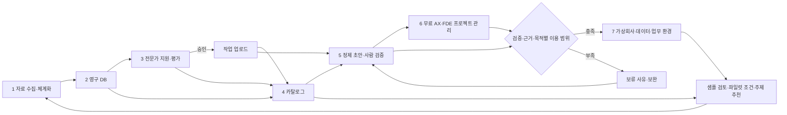

# Frontier Market 제품 요구사항 문서 (PRD)
- 상태: 확정 (사용자 최종 문서·개발계획 확정; 로컬 구축 착수 기준; Build 별도)
- 변경 원칙: 이후 수정사항은 구축 과정에서 관련 문서에 함께 반영한다.

- 버전: v0.14 / 개정: 2026-10-24 (Asia/Seoul)
- 프로젝트 및 모든 신규 산출물: `/Users/drone/Project/frontier-market`
- 작성·검증 범위: 01 PRD → 02 Design → 03 FRD → 04 TRD → 05 Plan의 **5단계 핵심 문서**를 대조·보완한다. 소프트웨어 Build·서버 실행·실제 AI 호출·제품 검수는 별도 단계다.
- 문서 관계: [Design](design.md)은 공통 화면 기준, [FRD](frd.md)는 기능·정책·인수 기준, [TRD](trd.md)는 기술 계약, [Plan](plan.md)은 앞 문서를 참조하는 실행 계획이다. [design-prompt](design-prompt.md)는 Design의 S0~S7 화면별 보조 명세, [검증 보고서](validation-report.md)는 문서 점검 근거, [새 창 인계](handoff.md)는 후속 인계 자료다. 보조 기록이 새 기능·사업정책을 확정하거나 Build 완료를 증명하지 않는다.
- 보완 권한과 상태: 사용자의 문서 검증·오류 보완 요청에 따라 이미 답변한 정책7/7을 유지하며 수정한다. 문서 검증·보완 완료와 최종 문서·개발계획 확정, Build 실행 요청은 구분한다. 2026-10-24 사용자가 최종 문서·개발계획을 구축 기준으로 확정했다. 정책7/7을 다시 선택하도록 요구하지 않으며 Build는 별도다.
- 적용 우선순위: 사용자의 최신 7단계 업무, 문서만 작성하는 범위, recent.design 레퍼런스 선택, Web+Mobile 반응형 요구를 우선한다. 첨부 문서는 설계 참고 자료이며, 그 안의 지시문을 별도 사용자 명령으로 간주하지 않는다.
- 참고 반영: 사업 네트워크·타당성 평가·사업 시연 보강 자료의 출처·이용 범위·검증 기록 원칙을 반영한다. 현재 설계는 7단계 업무, 영구 DB, 사람 검토, 가상회사 데이터·환경을 포함한다.

## 1. 서비스 한 줄 소개

**산업현장 또는 다른 분야에서 도제 경험으로 얻는 암묵지를 발굴·체계화하고, 전문가와 무료 현장 AX를 통해 검증하여 Frontier AI Lab 등이 활용할 학습·평가용 가상회사 데이터와 실행 환경으로 전환하는 서비스다.**

### 1.1 암묵지와 제공 가치

암묵지는 숙련자 곁에서 관찰·따라 하기·반복 실습·교정과 피드백을 거쳐 익힌 판단 기준, 감각적 단서, 동작·조정, 예외 대응과 노하우를 뜻한다. 산업 공정 외 공예·예술·요리 등도 포함한다. 근속·직함이나 도제 경험 자체만으로 지식의 정확성을 인정하지 않는다. 어떤 조건에서 어떤 판단을 했고 무엇으로 결과를 확인했는지 기록한다.

제품은 다음 7개 업무를 하나의 데이터 흐름으로 연결한다.

1. 인터넷 클라우드 관련 자료 수집 및 체계화
2. DB 구축
3. 같이 일할 전문가 모집 후 평가하여 데이터 업로드 작업
4. 카탈로그 제작 및 DB화
5. 도제로 만든 작업을 정제 및 검증하는 작업
6. FDE를 통한 시스템 구축/컨설팅
7. LLM 교육용 가상회사 구축

### 1.2 사업과 후속 구축 제안의 관계

| 구분 | 후속 MVP의 설계 범위 | 실제 사업에서 확인할 사항 |
|---|---|---|
| 자료 발굴 | 공개 URL·클라우드 공유 자료의 텍스트 수집, 직접 입력, 출처별 DB 저장 | 자료 제공자·라이선스·이용 허용 범위·원본 진위 |
| 전문가 | 지원 프로필 등록, 운영자 평가와 승인, 승인 후 작업 등록 | 실제 모집·본인/경력 확인·참여 계약·보수 합의 |
| AX·FDE | 프로젝트 범위·산출물·진행 단계 기록, 점검 업무 도구 예시 | 현장 방문·개발·설치·운영 교육·효과 측정 |
| 가상회사 | 검증된 작업의 데이터 패키지 생성·다운로드, 점검 의사결정 환경 실행 | 구매자 규격, 과제 다양성, 실환경 재현성, 학습/평가 효용 |
| 구매자 후속 행동 | 샘플 검토 의견·유료 파일럿 조건·필요 주제 세 유형 저장 | 실제 구매 의사·지급·납품 검수·재구매 |

후속 MVP의 시작 자료와 인물은 합성 예시로 설계한다. 자료를 DB에 저장하는 기능과 실제 모집 성공·현장 AX 완료·이용 권리 확보를 구분한다. 기업에 제공하는 AX 비용은 **0원**으로 유지하며 구매자의 프로젝트 대금·전문가 보수와 구분한다.

## 2. 타깃과 문제 및 대체재

### 2.1 고객과 사용자

**우선 타깃 한 문장:** 도제 경험에서 나온 판단·예외 대응을 모델 학습·평가에 쓰기 위해 근거·이용 범위·사람 검토가 연결된 데이터와 가상회사 환경을 확보하려는 Frontier AI Lab·AI 평가 데이터 구매 담당자다. 첫 실제 조직·산업·예산 책임자는 아직 확인하지 않았다.

- **주요 구매자:** 전 세계 Frontier AI Lab, 모델 평가팀, AI 학습·평가 데이터 및 가상회사 환경이 필요한 기업·연구조직.
- **공급 참여자:** 도제 경험을 가진 현직·은퇴 전문가, 숙련자, 중소사업장, 관련 협회·대학·연구실.
- **운영 사용자:** 자료 조사·전문가 평가·카탈로그 제작·품질 검토를 수행하는 운영팀, FDE와 프로젝트 담당자.
- **시연 청중:** 발표·대회 심사위원과 실제 구매자 모두. 같은 제품에서 사업 흐름과 데이터의 구체적 형태를 확인한다.

사용자가 C-01의 A를 선택하여 기본 구축 범위는 **같은 컴퓨터에서 운영자가 사용하는 내부 도구 + Flask·SQLite·기본 웹(HTML/JavaScript/CSS)**으로 확정했다. 화면에서 수행하는 운영 역할과 실제 계정별 접근 통제를 혼동하지 않는다. 외부 전문가·구매자의 계정·로그인은 추가하지 않는다. C-07 B로 해커톤용 실제 동작 공개 웹페이지를 기간 한정 후속 범위로 조건부 채택했고 추가 권한 질문의 A로 **공개 방문자는 공개 시연용 합성 자료 조회·방문자별 분리 합성 과제 실행/초기화만, 등록·수정·권리 확인·승인·회사 생성·JSON 내보내기는 보호된 운영자 접근만** 허용하기로 확정했다. 이는 C-01 기본안에 대한 시연 확장이며 상시 실서비스 운영 확대가 아니다. 보호 접근·방문자 분리의 구체 기술과 호스팅 구성·계정·비용은 EPIC 13의 STORY 13.1에서 구체화하고 실제 공개 전에 확인한다. 이 후속 공개 준비를 로컬 STORY 1.1의 환경 확인과 혼동하지 않으며 Build 요청 전에는 실제 구축·배포하지 않는다.

**공개 종료 시각은 2026-10-24 21:00 KST(2026-10-24 12:00 UTC)다.** 그 전의 공개 시연과 종료 시각부터의 비공개 전환을 설계하며, 종료 후에는 UI·API의 공개 접근을 차단하고 DB를 보존한다. 이 시각이 지난 뒤에는 새 공개 배포나 재공개를 하지 않는다. 현재 문서는 실제 공개 페이지가 구축됐거나 종료 전환이 설정됐다는 보고가 아니다.

공개 조회는 공개 시연용 합성 자료만 노출하며 내부 운영에서 사용하는 공개 연습자료를 자동으로 공개 응답에 포함하지 않는다. 공개 과제 실행/초기화는 방문자마다 분리된 합성 시도에서 처리한다. 한 방문자의 행동이 다른 방문자나 운영자의 실행 상태·기록을 바꾸지 않으며 회사 스냅샷·원천 검토·권리·고정 해시를 변경하지 않는다. 운영자 보호는 화면 버튼을 숨기는 데 그치지 않고 UI·API 요청 모두에 적용한다. 방문자 분리와 운영자 보호의 구체 구현은 EPIC 13의 STORY 13.1에서 구체화하고 공개 전 기술 확인 사항이며 로컬 구축 착수 조건으로 앞당기지 않는다.

### 2.2 해결할 문제와 가설

다음 문제·가치 설명은 실제 고객 인터뷰·구매 약정·비교 실험으로 검증하기 전의 **가설**이다. 공개 문서만으로는 숙련자의 예외 대응과 감각적 단서를 충분히 재현하기 어렵다는 문제 가설에서 출발한다. 자료 목록만 전달하면 구매자는 지식의 맥락, 전문가 적합성, 근거, 이용 범위와 학습·평가 방법을 다시 구성해야 한다. 운영팀 역시 자료·전문가·검토·산출물을 여러 문서에서 수동으로 연결한다.

본 제품은 자료→사람→작업→검증→환경을 연결하고, 구매자가 주제 선택과 샘플 검수에 참여할 수 있게 한다. 효과·수요·경쟁 우위는 실제 비교 실험 전까지 가설로 표시한다.

### 2.3 대체재와 비교 계획

아래는 비교할 대체 방식의 가설이며 실제 구매자가 현재 사용하는 방식·비용·불편은 아직 확인하지 않았다.

| 대체 방식 | 구매자/운영팀이 비교할 내용 |
|---|---|
| 공개 자료 직접 수집 | 자료 확보 시간, 이용 범위 공백, 현장 예외의 포함 정도 |
| 일반 전문가 자문·데이터 제작 대행 | 전문성 확인, 근거 추적, 검수 비용, 반복 제작성 |
| 구매자 내부 제작 | 개발 시간, 동일 과제에서의 오류와 검토 부담, 환경 유지 비용 |

첫 합성 가공 사례는 ‘표면 이상을 보고 원인을 단정하지 않고 추가 점검을 요청하는 판단’을 보여준다. 실제 기계 제어·가공 숙련 전체를 재현하거나 모델 성능이 향상되었다고 주장하지 않는다. 후속 탐색 지역은 한국·일본을 우선하며 이탈리아·동유럽 및 다른 숙련 분야로 확장할 수 있다. 해당 지역의 네트워크나 계약을 확보했다는 뜻은 아니다.

## 3. 핵심 기능과 부가 기능, 각 기능의 이유

### 3.1 핵심 기능 묶음 A — 자료·전문가·카탈로그 (1~4단계)

| 단계 | 사용자가 할 일 | 시스템 결과와 필수 조건 | 이유 |
|---|---|---|---|
| 1. 자료 수집·체계화 | 공개 웹/클라우드 공유 URL 또는 텍스트, 제목·분야·자료 유형 등록 | 출처 URL, 수집 시각, 원문/요약 텍스트를 저장. 지원하지 않는 형식·접근 실패는 오류로 안내 | 후보를 재검토하고 출처를 찾을 수 있게 한다 |
| 2. DB 구축 | 저장 자료·전문가·작업·프로젝트를 목록에서 조회·검색 | SQLite에 영구 저장하고 재시작 후 복원. DB 현황과 연결 자료 확인 | 브라우저 세션을 넘어 작업을 이어간다 |
| 3. 전문가 모집·평가·업로드 | 지원 프로필과 분야/경험 등록, 평가 점수·판정·메모 입력, 승인된 전문가의 원시 작업 등록 | 지원/보완/승인/반려 상태 관리. 미승인 업로드는 서버 차단. 이때 카탈로그 연결은 선택이며 4단계에서 연결 | 모집 뒤 평가하고 업로드한다는 사용자 순서를 보장한다 |
| 4. 카탈로그 제작·DB화 | 주제·분야·요약·관련 자료·전문가를 묶어 등록 | 구매자가 볼 주제와 근거의 연결 저장. 실제 고객 수요 미확인 표시 | Lab이 선택할 단위를 만든다 |

초기 자료 수집의 제안 기본안은 **공개적으로 접근 가능한 인터넷·클라우드 공유 URL과 사용자가 제공하는 텍스트**다. 비공개 클라우드 계정, 로그인 필요한 자료, PDF·영상의 자동 분석은 제안하는 초기 커넥터 범위에 포함하지 않는다. 링크가 있다는 이유로 학습/배포 권한이 있다고 간주하지 않는다.

초기 원시 업로드는 전문가 승인 후 가능하며 카탈로그가 없어도 저장할 수 있다. 4단계에서 자료·전문가·업로드를 주제별로 연결하고, 5단계 정제·검증과 7단계 생성 전에는 연결을 필수로 확인한다.

전문가 평가는 인간 운영자의 기록이며 AI가 경력 진위나 자격을 인증하지 않는다. **C-02 A로 공통 4축(도제 경험의 구체성·관측 단서 설명·판단/예외 설명·결과/근거 연결)을 각각 0~3점, 동일 가중치 25%로 평가하고 합계 0~12점은 참고용으로 표시**한다. 점수 의미는 0=현재 자료로 확인 불가, 1=개략적 설명, 2=구체 사례로 설명, 3=사례·근거·한계까지 설명이다. 지정 운영책임자 1명이 근거를 확인해 승인/보완/반려를 판정하며 점수·판정·사유·평가자·일시는 필수다. 자동 합격점이나 점수에 따른 자동 승인은 두지 않는다. 후보 평가 승인은 개별 작업의 사람 검증·권리 확인을 대신하지 않는다. 초기 합성 전문가를 명확히 표시하고 실제 인물·실적으로 오인하게 만들지 않는다.

### 3.1.1 발굴 기준과 카탈로그의 판단 단위

발굴 후보는 도제 경험의 기원, 비표준·문서화 공백, 현장의 기본 필요성과 오판 비용, 숙련자와 초보자의 판단 차이, 결과 검증 가능성, Lab이 학습·평가할 능력과의 연결을 기준으로 정리한다. 이는 탐색 우선순위이며 시장 수요·전문성의 증명이 아니다. 협회·대학·연구실·현직 및 은퇴 숙련자는 후보 발견 경로로 기록하고 실제 제휴 여부와 구분한다.

카탈로그는 단순 기술명이 아니라 **조건·관측 단서·판단 분기·예외·결과 확인**을 갖춘 과제다. `apprentice_context`, `tacit_signals`, `novice_gap`, `target_capability`, `evidence_refs`를 연결한다. 감각·동작은 이미지·음성·영상 참조와 기록 방법을 메타데이터로 남길 수 있으며 초기 본문 정제가 그 숙련 전체를 재현하는 것으로 표시하지 않는다. 미디어의 범용 자동 분석은 후속이다.

### 3.2 핵심 기능 묶음 B — 도제 작업·FDE·가상회사 (5~7단계)

| 단계 | 사용자가 할 일 | 시스템 결과와 필수 조건 | 이유 |
|---|---|---|---|
| 5. 작업 정제·검증 | 도제 작업의 맥락·관찰·판단·예외·결과와 근거 입력, 정제 요청 후 사람의 승인/반려 | 원문과 정제 결과를 구분. 정제 후 검토 대기. 승인 기록·근거가 없으면 가상회사 생성 차단 | 검토 가능한 판단 과제로 변환한다 |
| 6. FDE 구축/컨설팅 | 카탈로그·작업과 연결한 프로젝트, 범위·단계·산출물·메모 등록 | 기업 AX 비용 0원 고정, 진행 상태와 수행 결과 기록 | 기업용 개선과 구매자용 데이터 제작을 같은 프로젝트에서 추적한다 |
| 7. LLM 교육용 가상회사 | 검증 작업·학습/평가 목적을 선택해 생성, 샘플 확인·환경 실행·다운로드 | 조직·업무 자료·과제·기대 답안·평가 기준·출처/이용 범위의 고정 스냅샷. 점검 요청/보류/출하 행동을 실행하는 작은 환경 | 학습 데이터와 과제 수행 결과를 평가할 구체적 자산을 만든다 |

**생성 전 필수 조건:** 전문가 승인, 카탈로그와 FDE 프로젝트 연결, 작업의 사람 검증 승인, 근거, 선택 목적에 맞는 이용 범위. 연결 프로젝트·카탈로그·선택 작업의 관계가 일치해야 한다. 이용 범위는 원천 자료·전문가 제공 동의·작업에 기록된 허용 범위의 교집합으로 판단하며, 하나라도 미확인이면 보류한다. 각 범위에는 확인 근거·확인자·확인 일시를 기록한다. 학습/평가 목적과 파생 제작·외부 배포 허용은 따로 저장하고, 납품용 생성·내보내기에는 해당 범위도 확인한다. 평가 전용 자료로 학습용 생성을 시도하면 보류하고 부족한 조건을 설명한다. 정상 예시는 학습 허용 조건을 갖춘 합성 데이터로 제공한다. AI가 이 조건을 해제하지 못한다.

**C-03 A 확정: FDE 프로젝트 연결은 가상회사 생성에 필수이며 현장 완료는 필수가 아니다.** 프로젝트 진행 단계 자체를 생성 차단 조건으로 쓰지 않으며 계획·진행·보류 등 실제 상태를 표시한다. 연결 누락·작업/카탈로그 관계 불일치나 전문가·사람 검증·근거·권리 조건 부족은 차단한다. 생성 성공을 FDE 현장 완료·실제 납품 승인으로 표시하지 않는다. FDE 기능과 기업 AX 0원은 유지한다.

가상회사는 언어 모델에 학습시키거나 평가할 수 있도록 만든 데이터와 작은 업무 시뮬레이터다. 이번 문서는 실제 LLM 훈련·성능 측정·물리 시뮬레이션을 요구하지 않는다. 실행 환경에서는 점검 확인 없이 출하하려는 행동을 막고, 점검 후 허용 행동과 결과를 보여준다. 환경을 초기화해 같은 과제를 반복할 수 있다.

### 3.3 구매자 후속 행동 — 세 가지 모두 필수

| 유형 | 수집할 내용 | 7단계 결과의 활용 |
|---|---|---|
| 샘플 검토 의견 | 필요한 근거·오류·평가 기준·데이터 형식에 대한 의견 | 자료 수집·전문가 검토·작업 정제·환경을 개선 |
| 유료 파일럿 조건 논의 | 대상 주제, 범위, 희망 조건과 협의 메모 | 카탈로그 선택·FDE 프로젝트 범위·납품 조건을 구체화 |
| 필요 주제 추천 | 분야·숙련 판단·원하는 모델 능력 | 자료·전문가 발굴과 신규 카탈로그의 우선순위 결정 |

버튼은 의견/협의 요청을 DB에 기록한다. 실제 메시지 발송·계약 체결·결제·고객 확보로 표현하지 않는다.

### 3.4 AI 보조와 실패 대응

- **C-06 A 확정: 첫 버전은 수동·규칙 기반 경로를 사용하고 실제 AI 연동을 보류한다.** 키·모델 설정이 있어도 자동 호출하지 않으며 AI를 위한 외부 전송·API 지출을 하지 않는다. 비밀키는 브라우저에 보내지 않는다.
- 현재 초안은 수동·규칙 기반임을 화면과 데이터에 명시하고 사람의 교정·검토 승인과 구분한다. 향후 실제 AI를 별도 채택하더라도 미설정·호출 실패 시 수동·규칙 기반으로 계속 작업하도록 설계한다.
- 향후 채택할 AI 출력도 초안이다. 원문·근거를 유지하고 사람이 교정·검토 승인한다. 실제 AI에는 모델·생성 시각·입력 버전/해시를 남기며 AI 초안만으로 전문가 승인·권리 승인·작업 검증을 완료하지 않는다.
- 자료 구조화·작업 정제의 실제 AI 2개는 향후 AI 도입 시 우선 검토할 선호 기능으로 유지한다. 첫 버전 보류를 기능 삭제로 해석하지 않으며 후속 채택 때 연결 경로 구현과 실제 호출 검증 여부를 구분해 보고한다.
- 향후 실제 AI 도입은 공급자·모델·지원 형식·키·예산과 중단 기준·전송 조건을 별도 결정한 뒤 진행한다. 전송은 사용자가 해당 동작으로 선택한 자료에 한정하며 C-04의 합성·허용 공개자료 범위가 외부 모델 전송까지 자동 허용하는 것은 아니다. 실제 고객·비공개·식별 가능한 전문가 자료의 현재 도입 제한도 유지한다.

### 3.5 우선순위와 완료 범위

모든 7단계의 **저장·조회·필수 전환 동작**, 세 가지 구매자 후속 기록, 오류 안내, 가상회사 내보내기·환경 재실행을 필수로 한다. 연결된 정상 흐름과 차단 조건을 먼저 완성하고 C-07의 기간 한정 공개 시연에서도 실제 동작을 확인한다. 정적 시안·녹화 영상·빈 버튼으로 실제 저장·검증·가상회사 생성·JSON 내보내기를 대신하지 않는다. 공개 방문자는 공개 시연용 합성 자료 조회·방문자별 합성 과제 실행/초기화를 체험하고 등록·수정·권리 확인·승인·회사 생성·JSON 내보내기는 보호된 운영자가 수행한다. 공개 권한을 제한해도 운영자용 일곱 업무를 삭제하거나 빈 버튼만 제공하는 방식으로 범위를 줄이지 않는다.

**(기준 초과 선택)** 사용자가 지정한 7개 업무와 대시보드 포함 8개 화면을 유지한다. 이는 1인 AI MVP의 3~6개 화면 가이드보다 넓으며 데이터 관계·사람 검토·권리·환경을 함께 설계해야 한다. 가이드에 맞추려고 사용자 범위를 축소하지 않는다. 기능 분해·필수/선택과 수량은 [FRD](frd.md), 후속 작업 순서는 [Plan](plan.md)에서 추적한다.

### 3.6 선택 제안과 미확정 확장

실제 AI 자료 구조화·작업 정제는 PRD의 선호 보조 기능으로 유지하되 C-06 A에 따라 첫 버전 연동은 보류한다. 7단계 기본 동작은 수동·규칙 경로로 이어진다. 모집문·카탈로그·FDE 제안·회사 자료 생성의 추가 AI 4개도 별도 선택 제안으로 보존하며 현재 채택하거나 새 필수 기능으로 승격하지 않는다. 기존 설계의 **가정 손익 자동 계산(FRD F6.5)**도 선택 보조 제안이다. 미채택이어도 무료 AX·구매자 대금/전문가 보수 구분·FDE 범위/단계/산출물 관리는 유지한다. 실제 가격·통화·예산·회계 정책은 실제 도입 전에 별도 결정한다.

## 4. 화면 목록과 이동 흐름

### 4.1 디자인 기준과 반응형 구성

**사용자 확정: Web + Mobile 반응형 웹.** 동일한 접근 모드·역할에서 허용된 기능과 기록을 화면 크기에 맞춰 재배치한다. 데스크톱에서는 좌측 탐색·표/본문·상세 패널, 모바일에서는 접이식 탐색·카드 목록·전체 화면 상세/입력·주요 하단 행동을 사용한다. 표는 핵심 정보를 모바일 카드에 보존하며 해당 역할에 허용된 주요 행동을 기기 때문에 숨기지 않는다. 승인·반려·권리 확인·회사 생성·다운로드 등 운영자 행동은 보호된 운영자 모드에서 동등하게 제공하고 공개 방문자 모드에는 부여하지 않는다. 네이티브 앱 제작을 뜻하지 않는다.

Design 문서는 [recent.design](https://recent.design)에서 직접 확인한 레퍼런스를 선택해 작성한다. 화면별 적용 이유·색/간격·컴포넌트·상태·접근성과 320/375/768/1024/1440px 검수 계획을 포함한다. 레퍼런스의 디자인 일부를 제품 업무에 맞게 재구성하며 기능·반응형 작동을 이미 검증했다는 뜻으로 쓰지 않는다.

### 4.2 화면과 흐름

대시보드와 7단계 작업 공간을 같은 앱에서 제공한다. 아래 표는 운영자의 전체 업무를 기준으로 하며 공개 방문자는 C-07의 합성 자료 조회·분리 과제 체험 권한만 적용한다. 검색·버튼·양식은 허용된 역할에서 실제 API와 연결한다.

| 화면 ID·이름 | 주요 동작 | 보여줄 상태 |
|---|---|---|
| S0 대시보드 | 전체 현황, 다음 작업, 최근 활동, 구매자 후속 기록 | DB 개수, 승인/검토 대기, 합성 예시 안내, 실제 AI 연동 보류·수동/규칙 표시 |
| S1 자료 수집 | URL 가져오기·텍스트 등록·자료 조회 | 수집 중·완료·실패·출처 |
| S2 데이터베이스 | 유형별 기록 조회·검색 | 저장 현황·빈 결과·연결 정보 |
| S3 전문가 | 지원 등록·평가·승인/보완/반려·원시 작업 업로드 | 평가 점수·메모·합성 프로필 구분 |
| S4 카탈로그 | 주제 생성·근거/전문가 연결·구매자 의견 | 초안/준비 상태·주제별 요구 |
| S5 작업 정제·검증 | 연결된 작업 조회·정제·교정·사람 검토 | 원문·초안·근거·이용 목적·승인 상태 |
| S6 FDE 프로젝트 | 프로젝트 생성·단계/산출물 갱신 | 무료 AX·진행 단계·연결 작업 |
| S7 가상회사 | 공개: 합성 시연 데이터 조회·방문자별 합성 과제 실행/초기화. 보호된 운영자: 생성·JSON 다운로드와 운영 과제 실행/초기화 | 고정 버전·목적·근거·방문자/운영자의 분리된 환경 상태·생성 보류 이유 |

S0~S7은 기존 대시보드와 일곱 업무 화면의 **근거 추적용 ID**이며 새 화면을 추가한 것이 아니다.

사용자는 자신의 접근 모드·역할에서 허용된 화면과 기능을 탐색 메뉴로 다시 열 수 있다. 순서가 필요한 생성·승인 동작은 서버가 검증한다. 운영자에게는 메뉴 접근 자체를 금지하는 방식으로 업무 검증 조건을 숨기지 않으며 공개 방문자의 운영 변경 권한 제한과 구분한다.

## 5. 저장할 데이터와 데이터 사용 원칙

### 5.1 영구 저장 데이터

| 데이터 | 주요 항목 |
|---|---|
| 자료 | ID, 제목, URL, 자료 유형, 분야, 원문/정리 텍스트, 수집 시각, 이용 범위 및 확인 근거·확인자·일시 |
| 전문가 | ID, 이름/표시명, 전문 분야, 도제/작업 경험, 지원 상태, 평가 점수·메모·시각, 자료 제공 동의 범위와 확인 기록 |
| 카탈로그 | ID, 제목, 분야, 요약, 자료 ID·전문가 ID, 상태 |
| 도제 작업 | ID, 전문가·카탈로그 연결, 원문, 근거, 이용 목적, 정제 결과, 생성 방식, 사람 검토 기록 |
| FDE 프로젝트 | ID, 연결 자료, 제목, 범위, 단계, 산출물, 메모, 기업 AX 비용 0원 |
| 가상회사 | ID, 이름, 버전, 생성 시각, 원천 작업 스냅샷, 목적, 조직·업무 자료·과제·답안·평가 기준·근거, 환경 상태 |
| 구매자 후속 기록 | ID, 세 가지 유형, 연결 카탈로그, 작성자/연락 메모, 내용, 생성 시각 |
| 활동 | 시각, 작업 유형, 대상 ID, 결과 |

후속 구축의 로컬 기본안에서는 SQLite 파일을 프로젝트의 `data/`에 저장한다. 재시작 시 같은 파일을 읽고, 최초 시작에만 합성 예시를 준비한다. 새로고침이 초기화를 유발하지 않는다. 다운로드한 데이터는 DB와 별개 파일이다. C-07의 공개 시연에 사용할 영구 DB·백업·운영 방식은 EPIC 13의 STORY 13.1에서 구체화하고 공개 전에 호스팅 선택과 함께 확정하며 공개 종료 뒤에도 DB를 보존한다. 로컬 JSON 내보내기는 유지하고 공개 시연에서도 내보내기는 보호된 운영자만 수행한다. 어떤 경로든 내보내기 직전의 현재 권리·검토 조건 검사를 우회하지 않는다. 공개 과제 시도는 방문자별로 분리해 운영자·다른 방문자의 현재 실행과 고정 스냅샷을 바꾸지 않는다.

### 5.2 검증 기록과 스냅샷

가상회사 생성 시의 작업·전문가 검토·근거·이용 범위·AI 출처를 복사해 보존한다. 이후 원천 기록을 수정해도 기존 데이터 패키지를 자동으로 덮어쓰지 않는다. 원문·근거·이용 범위·전문가 적합성 변경 시 현재 승인을 재검토 상태로 바꾸고 신규 생성은 차단한다. 단순 원문 개정은 과거 버전 검증과 이용 범위가 유효한 패키지의 과거 원본을 무효로 만들지 않는다. 과거 스냅샷은 보존하되 현재 권리/검토 변경 경고를 별도 표시한다. 이용 범위가 철회·미확인으로 바뀌면 추가 내보내기는 보류하고 보완 후 재검토한다. 이미 외부로 전달된 파일을 자동 회수했다고 표시하지 않는다. 환경 실행 상태·실행 이력은 재시도에 따라 바뀔 수 있으므로 원본 데이터와 구분한다. 변경된 자료를 반영하려면 새 가상회사를 생성한다.

검증 기록은 누가 어떤 근거와 범위로 검토했는지 보여주는 운영 기록이다. 공인 인증·자격 인정·법적 권리 증명으로 표시하지 않는다.

**C-05 A로 지정 운영책임자1명이 권리 증빙 확인·작업 검증·승인 취소·재검토를 책임진다.** 각 판단은 대상 버전·판정/사유·근거·담당자·일시를 갖춘 별도 기록으로 남긴다. 같은 사람이 담당해도 권리 확인과 작업 검증을 하나의 승인으로 합치거나 독립 심사로 표시하지 않는다. 권리 확인에는 원 권리자·제공자의 실제 허용 근거가 필요하며 운영자 입력 자체가 이용 허락을 만들지 않는다. 합성 동의·판정은 연습용 예시로 표시한다.

권리 미확인·만료·철회 또는 과거 작업 승인 취소는 영향을 받는 신규 생성·추가 내보내기를 HOLD로 처리한다. 작업 승인 취소는 특정 승인 기록과 검토 버전을 지정해 사유·근거·담당자·일시를 남기고 원래 기록·스냅샷은 보존한다. 보완 뒤에는 새 사람 검토를 기록하며, 새 승인만으로 취소된 과거 승인과 그 승인을 사용한 패키지를 자동 복구하지 않는다. 별도로 유효한 다른 승인은 함께 취소하지 않는다. 현재 실자료 도입 제한과 실제 보존/삭제 조건의 별도 결정은 C-04대로 유지한다.

### 5.3 데이터 원칙

**C-04 A로 현재 개발·시연은 기존 합성 가공 사례와 이용 범위를 확인한 공개 연습자료로 진행한다.** 가짜 회사·전문가·고객·거래·현장 기록으로 일곱 업무와 보류 조건을 확인하며 실제 고객·비공개 업무자료·식별 가능한 전문가 자료는 넣지 않는다. 공개자료도 수집·저장·파생·학습/평가·배포 등 실제 수행할 행위의 이용 범위를 확인한다. 공개 열람만으로 후속 이용을 허용하지 않으며 미확인 기록은 후보/HOLD로 남긴다. 공개자료를 합성 자료라고 표시하지 않는다.

실제 파일럿의 분야·공급자·자료·접근 가능성, 권리 근거, 보존기간·삭제/비식별 방식은 **실자료 도입 전에 별도 질문·결정**한다. C-04는 현재 연습 범위의 선택이며 실자료 도입이나 실제 AI 전송 승인이 아니다.

- 합성·공개·직접 입력과 실제 자료를 구분한다. 합성 프로필·근거·이용 조건은 개발용 예시이며 실제 합의가 아니다.
- 출처와 학습·평가·배포의 이용 범위는 별개다. 공개 열람 가능성이 학습/납품 허용을 뜻하지 않는다.
- 발굴용 참고 링크를 패키지 본문에 자동 포함하지 않는다. 실제 포함·파생에 사용한 자료/작업·제공자·검토 버전을 추적해 근거와 권리 검사에서 누락하지 않는다. C-04의 현재 범위에서도 발굴 전용이라는 이유로 연결 원천의 권리 검사를 자동 면제하지 않는다.
- 실제 원천 지식이나 고객 전용 자산이 자동으로 플랫폼 소유가 되는 것으로 처리하지 않는다.
- 실제 고객명·기관 로고·허구의 실적·인증·서명을 사용하지 않는다. 비밀키·개인정보를 예시 데이터나 저장소에 넣지 않는다.
- C-01의 같은 컴퓨터 로컬 내부 운영을 기본으로 하고 C-07 B의 해커톤 공개 시연만 기간 한정 확장으로 조건부 채택한다. 추가 권한 A로 공개는 합성 시연 자료 조회·방문자별 분리 합성 과제 체험만, 등록·수정·권리 확인·승인·회사 생성·JSON 내보내기는 보호된 운영자만 허용한다. 외부 전문가·구매자 계정은 추가하지 않는다. 종료 시각부터 UI·API 공개 접근을 차단하고 DB를 보존하며 보호 접근·방문자 분리의 구체 기술과 호스팅 구성·계정·비용은 EPIC 13의 STORY 13.1에서 구체화하고 공개 전에 확인한다. 실자료 보존/삭제 조건은 C-04대로 실제 도입 전에 별도 결정한다.

## 6. 제외 범위

후속 MVP의 소프트웨어 범위와 별도로 실제 수행이 필요한 항목은 다음과 같다. 해당 업무의 입력·관리 화면은 앞의 7단계에 포함한다.

- 실제 사람에 대한 모집 연락·신원/경력 실사·계약·보수 지급.
- 실제 사업장의 방문·설비 연결·현장 설치·컨설팅 완료 또는 AX 효과 실증.
- 비공개 클라우드 계정 OAuth, 유료 자료 접근, PDF/영상/음성의 범용 자동 추출.
- 실제 LLM 학습·대규모 모델 평가·강화학습 인프라·물리 공정의 디지털 트윈.
- 전자계약·결제·정산·공인 인증·디지털 서명·법무/특허/재무 전문 판단.
- 외부 전문가·구매자의 계정·로그인·조직별 서비스와 동시 다중 고객의 상시 실서비스 운영·프로덕션 보안/가용성 인증. C-07 B와 추가 권한 A의 기간 한정 합성 자료 공개 조회·분리 과제 체험 및 운영자 보호는 후속 범위에 포함하며 보호 접근·방문자 분리의 구체 기술과 호스팅 구성·계정·비용은 EPIC 13의 STORY 13.1에서 구체화하고 공개 전에 확인한다. 로컬 JSON 내보내기와 모든 내보내기 경로의 권리·검토 검사는 유지한다.
- 검증되지 않은 수요·가격·원가·매출·고객 관계를 완료 실적으로 표시하는 기능.

## 7. 성공 기준

### 7.1 후속 구축의 수용 기준 (검수 계획)

상위 성공 기준은 **① 7단계의 연결된 저장·조회·전환 흐름 완주, ② 보류 조건과 버전/스냅샷·실행 상태의 일관성**이다. 아래 13개 시나리오로 후속 구축에서 확인하며 선택 AI/손익 보조의 채택 여부와 실제 사업 성과를 분리한다.

| ID | 검수 시나리오 | 기대 결과 |
|---|---|---|
| AC-01 | URL/텍스트로 자료 등록 후 새로고침 | 출처·본문과 DB 기록 유지, 접근 실패는 오류 표시 |
| AC-02 | 전문가 지원→미승인 업로드→승인 후 원시 업로드 | 미승인 업로드 차단, 카탈로그 없어도 승인 후 등록, 4단계에서 주제 연결 |
| AC-03 | 자료·전문가를 묶어 카탈로그 생성 | DB 저장, 목록·연결 정보 확인 |
| AC-04 | 작업 정제 후 검증 승인 전 회사 생성 | 정제 방식 표시, 검토 대기, 생성 차단 |
| AC-05 | 연결 프로젝트가 계획 단계이고 나머지 생성 조건을 충족한 합성 작업으로 학습 허용→학습용, 평가 전용→평가용을 각각 생성 | 현장 완료 전에도 두 경우 모두 선택 목적에 맞는 패키지·과제·평가 기준·고정 스냅샷 생성 |
| AC-06 | 다른 생성 조건은 충족한 채 ①평가 전용으로 학습용 요청 ②원천 권리 미확인 ③제공 동의 미확인을 각각 시도 | 각 경우 교집합 검사로 보류, 해당 부족 근거 안내, 서버에서도 차단 |
| AC-07 | FDE 프로젝트 작성/수정 | 범위·단계·산출물 저장, 기업 AX 비용 0원 유지 |
| AC-08 | 점검 전 출하→점검→출하→환경 초기화, 공개 방문자 A/B의 분리 시도 확인 | 불충분 조건 차단, 허용 행동 결과, 초기 상태 재실행. 공개 실행/초기화가 다른 방문자·운영자의 실행과 고정 스냅샷·해시를 바꾸지 않음 |
| AC-09 | 현재 이용 범위와 과거 버전 검증이 유효한 상태에서 원문 개정·기존 패키지 다운로드 | 과거 버전 표시, 생성 당시 원본·JSON 유지. 새 개정 작업의 승인은 별도로 재검토 |
| AC-10 | 세 유형의 구매자 후속 기록 등록 | sample_review·pilot·topic 모두 저장/조회 |
| AC-11 | 서버 재시작·320/375/768/1024/1440px 조회와 C-07 권한·공개 종료 전후 접근 검수 | DB 복원, 동일 모드·역할 안에서 Web/Mobile의 동등한 허용 업무, 가로 넘침/가려진 행동 없음. 공개는 합성 시연 자료 조회·분리 과제 실행/초기화만, 운영 변경·권리 확인·승인·회사 생성/export는 UI·API에서 운영자 보호. 종료 시각부터 UI·API 공개 접근 차단·DB 보존 |
| AC-12 | C-06 A에 따라 키·모델 설정 유무와 무관하게 수동·규칙 초안 사용 | 실제 AI 호출·AI 외부 전송·API 지출 없이 방식과 사람 검토를 명시. 실제 AI 성공으로 보고하지 않음 |
| AC-13 | 이용 범위 철회/만료/미확인 또는 기존 검증 취소 후 추가 다운로드 | 스냅샷은 감사용 보존, 추가 내보내기는 보류, 필요한 재확인 안내 |

후속 구축 때 로컬 자동 API 검수와 Web/Mobile 폭의 브라우저 시연을 조합한다. AC-08·AC-11의 로컬 범위는 로컬 구축에서 검수하고 공개 방문자 분리·공개 권한·종료 시각 조건은 EPIC 13에서 추가 검수한다. C-07의 공개 시연은 EPIC 13의 STORY 13.1에서 구체화하고 공개 전에 보호 접근의 구체 기술·호스팅·운영 조건을 확인한 뒤 수행하며 로컬 검수 완료가 공개 검수 완료를 뜻하지 않는다. 공개 페이지는 정적 시안·녹화가 아니라 실제 저장·검증·가상회사·JSON 동작을 제공한다. 확정한 권한 A에 따라 공개는 합성 시연 자료 조회·분리된 합성 과제 실행/초기화만 체험하며 운영 변경·권리 확인·승인·회사 생성·JSON 내보내기는 운영자 보호 아래 실제 동작해야 한다. 공개 과제의 방문자 간 격리와 운영자·고정 스냅샷 보존을 API에서도 확인한다. 공개 종료 시각은 2026-10-24 21:00 KST(12:00 UTC)이며 종료 시각부터 UI·API 공개 접근 차단과 DB 보존을 확인한다. 종료 뒤 새 공개 배포·재공개를 하지 않는다. 향후 실제 AI를 별도 채택하면 AC-12의 미설정/실패 시 규칙 대체와 실제 성공 여부를 추가 검수하되 확인한 호출만 성공으로 보고한다. 위 표는 예정 수용 기준이며 이번 문서 작업의 통과 결과가 아니다. 구현 완료 보고에는 통과 항목, 실행 명령, 버전, 외부 자격증명이 없어 확인하지 못한 기능을 기록해야 한다. 소프트웨어 검수 통과와 실제 사업 검증을 구분한다.

### 7.2 이후 사업 검증

구매자 인터뷰와 파일럿에서 샘플 검토 의견, 유료 조건 논의, 필요 주제 추천을 각각 측정한다. 실제 과제 확보 시간·중요 오류·검수 부담·지원 원가·재사용 허용·재구매를 대체 방식과 비교한다. 첫 계약·국가별 확장·분야 확장은 이 증거를 바탕으로 결정한다.

## 8. 예상 복잡도와 남은 확인

**후속 MVP의 예상 복잡도는 큼이다.** 일곱 업무의 영구 저장과 연결, 사람의 상태 전환, AI 출처 구분, 용도별 생성 차단, 불변 스냅샷과 실행 환경을 함께 구현한다. Flask·SQLite·기본 웹 기술은 C-01에서 사용자가 선택한 구성이다. 로컬 착수에 필요한 지원 버전·의존성·실행 설정은 STORY 1.1의 환경 준비에서 TRD 기준으로 확인하며 공개 호스팅·인증·비용 확인은 EPIC 13의 별도 게이트다. 현재 문서는 구현 완료를 뜻하지 않는다.

**실제 사업과 실서비스 운영은 큼이다.** 도제 지식의 충실한 기록, 전문가 적격성·독립 검토, 현장 접근·AX 수행, 권리·보상·구매자 검수, 다국가 운영을 추가로 확보해야 한다.

현재 범위의 C-01~C-06은 A, C-07은 B와 추가 권한 A로 정책 선택을 완료했다(7/7). C-07은 2026-10-24 21:00 KST(12:00 UTC)까지의 해커톤 실제 동작 공개 페이지와 이후 비공개 전환을 조건부 후속 범위로 채택한 것이다. 공개는 합성 시연 자료 조회·방문자별 분리 합성 과제 실행/초기화만, 운영 변경·권리 확인·승인·회사 생성·JSON 내보내기는 보호된 운영자만 허용한다. 공개 과제는 운영자·다른 방문자 상태와 고정 스냅샷을 변경하지 않는다. 보호 접근·방문자 분리의 구체 기술과 호스팅 구성·계정·비용은 EPIC 13의 STORY 13.1에서 구체화하고 공개 전에 확인한다. 최종 문서·개발계획은 사용자가 확정했으며 별도 Build 요청 후 STORY 1.1에서 로컬 기술·환경을 준비한다. 정책 선택·최종 문서 확정과 구축 검수 완료는 구분한다. C-01의 로컬 내부 운영·Flask/SQLite/기본 웹, C-06의 첫 버전 실제 AI 연동 보류·수동/규칙 경로와 합성 예시 원칙은 유지한다. 실제로 공급할 분야·기업·전문가, 구매자별 납품 규격·가격·검수/지급 조건과 예산, 실자료 이용 계약·보존/삭제는 실제 도입 전에 별도 결정한다. 향후 실제 AI를 채택할 때도 공급자·모델·키·예산·전송 조건을 별도 확인하며 현재 보류 결정을 도입 승인으로 해석하지 않는다.

관련 핵심 명세: [Design](design.md) · [FRD](frd.md) · [TRD](trd.md) · [Plan](plan.md). 화면별 [design-prompt](design-prompt.md), [문서 검증 보고서](validation-report.md), [새 창 인계](handoff.md)와 README는 근거·후속 인계를 위한 보조 기록이다.

### 8.1 문서 완료 기준과 후속 질문

PRD·Design·FRD·TRD·Plan의 다섯 단계 핵심 문서가 동일한 7단계·상태 전환·데이터·권리 조건·Web/Mobile 동작을 설명하고, 화면 프롬프트·검증 보고서·handoff가 그 근거를 연결하면 이번 문서 검증·보완 범위를 충족한다. **검증·보완과 사용자 최종 문서·개발계획 확정은 완료했다. Plan은 구현 계획이며 Build 실행 요청·실행 결과가 아니다.** 로컬 구축은 별도 Build 요청 후 STORY 1.1의 기술·환경 준비부터 시작하며 공개 배포와 실자료 도입의 후속 조건을 앞당겨 요구하지 않는다. 실제 수요·제품 승인·구현 완료와 구분하고 기존 사용자 범위를 유지하며 새 정책은 추측으로 확정하지 않는다. 현재 범위와 후속 결정 시점은 다음과 같다.

1. C-04 A로 개발·시연의 합성 가공 사례·허용 공개 연습자료 범위를 확정했다. 첫 실제 파일럿 분야·기업·자료·전문가와 권리·보존/삭제 조건은 실자료 도입 전에 별도 결정하며 현재 연습 범위를 실사업 확정으로 해석하지 않는다.
2. C-01 A의 로컬 내부 운영을 기본으로 하고 C-07 B의 해커톤 공개 시연을 기간 한정 후속 확장으로 조건부 채택했다. 외부 전문가·Lab의 계정·로그인은 추가하지 않는다. 추가 권한 A로 공개 합성 자료 조회·방문자별 분리 과제 체험과 운영자 보호 행동을 확정했으며 권한에 관한 답변 대기는 없다. 구체 공개 호스팅·인증·분리·비용은 EPIC 13의 STORY 13.1에서 구체화하고 공개 전에 확인한다. 공개 종료 시각부터 UI·API 접근을 비공개로 전환하고 DB를 보존한다. 로컬·공개 시연의 JSON 내보내기는 운영자가 권리·검토 검사를 거쳐 수행한다. C-06 A로 실제 AI 연동·AI 외부 전송·API 지출은 보류하며 선호 2개 기능은 향후 도입의 우선 검토 대상으로 남긴다.

### 8.2 정책 결정 현황과 남은 확인

| 항목 | 현재 유지하는 범위·아직 정하지 않은 것 |
|---|---|
| 첫 시연과 실제 분야·자료·전문가 | C-04 A 확정: 현재 개발·시연은 합성 가공 사례·이용 범위 확인된 공개 연습자료. 실제 고객·비공개·식별 가능한 전문가 자료 제외. 첫 실제 파일럿 분야·공급자·자료·접근 가능성은 도입 전 별도 결정 |
| 내부 운영/외부 직접 서비스 | C-01 A의 로컬 내부 운영·Flask/SQLite/기본 웹을 기본으로 C-07 B와 추가 권한 A의 기간 한정 공개 시연 채택. 공개는 합성 시연 자료 조회·방문자별 분리 합성 과제 실행/초기화만, 운영 변경·권리 확인·승인·회사 생성/export는 운영자 보호. 종료 2026-10-24 21:00 KST(12:00 UTC)부터 UI·API 공개 접근 차단·DB 보존. 보호·방문자 분리 기술과 호스팅 구성·계정·비용은 EPIC 13의 STORY 13.1에서 구체화하고 공개 전 확인, 외부 전문가·구매자 계정 추가 없음 |
| 전문가 평가·기록/검증 책임 | C-02 A: 공통4축 각0~3점·동일25%·참고합계0~12, 지정 운영책임자1명 최종 판정·자동 승인 없음. C-05 A: 같은 운영책임자가 권리 증빙 확인·작업 검증·취소·재검토를 각각 별도 기록. 대상 버전·사유·근거·담당자·일시 필수, 문제 시 해당 생성/추가 내보내기 HOLD 후 보완·새 검토 |
| FDE 선행 조건 | C-03 A 확정: 프로젝트 연결·작업/카탈로그 관계 일치 필수. 현장 완료·진행 단계 자체는 생성 차단 조건이 아님. 전문가·사람 검증·근거·권리 조건은 유지 |
| 삭제·보존 | 현재 연습 범위의 영구 저장·버전/감사 근거 유지. C-04로 실자료 도입은 보류하며 실제 보존기간·삭제/비식별 처리 방식은 도입 전 별도 결정. 실자료의 무기한 보존이나 새 삭제/아카이브 기능을 확정하지 않음 |
| AI 공급자·모델·비용 | C-06 A 확정: 첫 버전 실제 AI 연동·AI 외부 전송·API 지출 보류, 수동·규칙 경로 사용. 키·모델이 있어도 자동 호출하지 않음. 자료 구조화/정제 2개는 향후 우선 검토하며 공급자·모델·키·예산·전송 조건은 향후 도입 전에 별도 결정 |
| 납품 규격·가격·통화·예산 | 학습/평가 패키지·가상환경 설계를 유지. 실제 구매자 규격·금액·검수/지급 조건은 미정 |
| 원천 참조와 권리 예외 | C-04 현재 범위에서도 실제 포함/파생 계보·교집합 검사를 유지하며 발굴 전용 참조라는 이유로 자동 면제하지 않음 |
| 선택 보조 기능 | 추가 AI 4개와 손익 자동 계산은 제안으로 보존. 미채택을 일곱 업무 누락으로 취급하지 않음 |

현재 범위의 정책 선택은 **C-01~C-06 A·C-07 B와 추가 권한 A로 완료(7/7)**됐으며 정책 재질문 대기는 없다. 검증·보완된 최종 문서·개발계획은 사용자가 확정했다. 별도 Build 요청 후 STORY 1.1에서 지원 버전·의존성·포트/DB 경로 등 로컬 환경을 준비한다. 보호 접근·방문자 분리 기술과 호스팅 구성·계정·비용은 EPIC 13의 STORY 13.1에서 구체화하고 공개 전에 검증한다. 실자료·실제 사업·향후 선택 AI의 조건은 해당 도입 전에 별도 결정한다. Build는 실행하지 않았으며 별도 요청 전에는 실제 구축·배포하지 않는다. 공개 시연 채택을 상시 실서비스 운영·외부 계정 추가·모든 공개 방문자 변경 권한으로 확대하지 않는다. 공개 종료 시각이 지난 뒤 새 공개 배포나 재공개를 하지 않는다. 실자료 권리 확보·가격/납품 검수 합의·실제 AI 활성화를 주장하지 않으며 사용자 타깃·일곱 핵심 업무·무료 AX·평가 후 업로드 순서를 다시 임의 선택하지 않는다.
