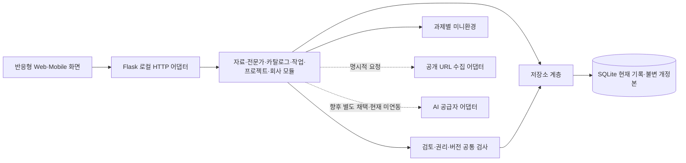

# TRD — 후속 구축을 위한 기술 설계

- 상태: 확정 (기술 기준 사용자 확정; 로컬 구축 시작 준비 완료·공개 배포 조건부; Build 별도)
- 변경 원칙: 이후 수정사항은 구축 과정에서 관련 문서에 함께 반영한다.

- 버전: 1.8 / 검증·개정일: 2026-10-24 (Asia/Seoul)
- 기준: [PRD](prd.md), [FRD](frd.md), [Design](design.md), `vibe:04-trd`의 문서 구성·기술 검토 항목.
- 이 문서는 후속 구축 설계입니다. C-01의 기술·운영 구성은 사용자 선택으로 확정했으며 나머지 정책은 해당 결정 기록을 따릅니다. 코드 구현·서버 실행·API 시험·실제 AI 호출·전체 제품 승인 완료를 뜻하지 않습니다.
- 프로젝트와 모든 후속 산출물의 기준 경로는 `/Users/drone/Project/frontier-market`입니다. 이번 작업에서는 문서만 보완합니다.

## 1. 선택한 스택과 선정 이유·비교 대안

프런트엔드는 사용자가 보는 화면, 백엔드는 요청을 처리하는 주방, 데이터베이스는 기록을 보관하는 장부에 해당합니다. **같은 컴퓨터의 내부 운영 도구 + Flask·SQLite·HTML/JavaScript/CSS를 기능별 모듈로 나눈 하나의 프로그램**을 사용자가 C-01의 A로 선택했습니다. 외부 전문가·구매자의 계정·로그인은 첫 버전에서 제외합니다. 설치·구축·실행·배포는 별도 Build 지시 전까지 하지 않습니다.

| 패키지 | 구성과 적합성 | 로컬 월 추가 사용료 | 익히기·변경 난이도 |
|---|---|---|---|
| A. 사용자 선택 | Flask + SQLite + HTML/JavaScript/CSS. 같은 컴퓨터의 운영자가 계정 없이 7단계·영구 저장·승인·권리·실행 규칙을 관리 | 로컬 호스팅·DB 0원, C-06 실제 AI/API 지출 보류. 해커톤 호스팅 비용은 배포 전 확인. 기존 기기·전기·인터넷·인건비 제외 | 배우기 보통. 프레임워크의 라우팅·오류 처리 틀 사용. 향후 운영 서버·접근 제어 추가 보통 |
| B. 비교 대안·미채택 | Python 표준 라이브러리 HTTP 어댑터 + SQLite + 같은 프런트 | 오픈소스 로컬 실행 추가 사용료 0원 + 선택 AI | 외부 의존성 적음. HTTP/검증 코드 직접 관리, A로부터 전환 보통 |
| C. 외부 협업 중심 확장 | Python 웹 API + PostgreSQL + 같은 웹 화면. 동시 사용자·중앙 DB·로그인을 별도 설계할 때 비교 | 직접 로컬 실행은 소프트웨어 사용료 0원. 관리형 DB·인증·호스팅은 선택 서비스 견적 추가, 현재 미확정 | 초기 설치·운영 부담 큼. DB 마이그레이션·권한 추가는 어려움 |

**A의 이유와 결정 근거:** 2026-10-24 사용자가 C-01 질문의 A를 선택했습니다. 여러 API의 경로·요청·오류 처리 틀은 Flask로 통일하고 업무·권리·검토 규칙은 기능 서비스에서 관리합니다. 외부 서비스 없이 자료→전문가→카탈로그→검증→가상회사를 연결합니다. 로컬 기술 기준은 CPython 3.14.x·Flask 3.1.3·표준 sqlite3로 정리합니다. 정확한 Python 보안 패치와 전이 의존성 고정·포트·DB 경로 확인은 별도 Build 요청 후 STORY 1.1에서 수행합니다. 이는 기술·운영 선택의 재승인 질문이 아닙니다. Flask가 인증·권리 검사·운영 보안을 자동 제공한다는 뜻도 아닙니다.

**추천 유지와 한계:** 기능은 단순해도 참조 버전·사람 검토·권리 교집합이 있어 기술 복잡도는 PRD와 같은 큼입니다. 서비스를 여러 개로 쪼개지 않고 한 프로그램 안에서 책임을 나눕니다. 별도 분산 처리·이벤트 소싱·복잡한 명령/조회 분리를 도입하지 않습니다. 현재 요구에 없는 모바일 네이티브 앱·비공개 클라우드 계정 연결도 스택 선택에 포함하지 않습니다.

로컬 구현을 기본으로 하며 C-07 B로 해커톤의 실동작 공개 웹 시연을 후속 범위에 포함했습니다. 공개는 2026-10-24 21:00(Asia/Seoul)까지만 허용하고 이후 비공개로 전환합니다. 이번 요청은 구축에 앞선 문서·계획 반영이며 아직 구축·실행·배포하지 않습니다.

## 2. 시스템 구조와 기능 추적

**모듈러 모놀리식**은 부서별로 방을 나누되 같은 건물에서 일하는 구조입니다. 화면·HTTP·업무 규칙·DB 접근을 분리하지만 한 프로젝트·한 배포 단위·한 로컬 DB를 사용합니다. 업무 서비스는 HTTP 요청 객체를 직접 참조하지 않아 나중에 서버만 교체할 수 있어야 합니다.



| FRD 기능 | 화면 | 기술 책임·핵심 저장 |
|---|---|---|
| F1 수집·체계화 | S1 | sources: 수집 원문·구조화 초안·명시적 채택·출처 |
| F2 DB·대시보드 | S2·S0 | 검색/필터·카운트·활동·참조·개정본 조회 |
| F3 전문가 | S3 | experts: 점수/판정/경험 기록·승인 후 무카탈로그 원시 업로드 |
| F4 카탈로그 | S4 | catalogs: 발굴 6축·도제 단서·자료/전문가/작업 연결 |
| F5 정제·검증 | S5 | works: 초안·사람 교정·근거·버전 지정 검토 |
| F6 FDE | S6 | projects: 범위·담당·일정·현장 인수/Lab 검수·가정 손익 |
| F7 가상회사 | S7 | companies·company_runs: 목적별 패키지·과제별 실행/초기화·내보내기 |
| F8 세 유형 의견 | S0·S4·S7 | feedback: sample_review/pilot/topic·보완 대상 연결 |
| F9 권리·버전 | S1·S3·S5·S7, 이력 S2 | rights_grants·document_revisions·review_events |
| F10 선택 AI | 별도 화면 없음 | ai_runs: 기능별 초안·실제 AI/규칙 출처·사람 채택 |

FRD의 F1~F9 필수 49개 세부 기능을 제외하지 않습니다. F6.5 손익 보조 1개는 기존 설계의 선택 제안이며 필수로 승격하지 않습니다. F10의 선택 AI 6개는 자료 구조화·작업 정제의 우선 연동과 모집문·카탈로그·FDE·회사 자료의 추가 제안을 구분합니다. C-03 A로 회사 생성의 project 연결·작업/카탈로그 관계 일치는 필수이며 현장 완료·프로젝트 진행 단계 자체는 생성 차단 조건이 아닙니다. 전문가·사람 검증·근거·권리 게이트는 유지합니다.

## 3. 데이터 모델·접근 규칙

테이블은 엑셀 시트, 필드는 시트의 열에 해당합니다. 아래 예시는 전부 합성입니다. ID는 서버 발급 문자열, 시각은 UTC ISO 8601, 한국어 화면은 Asia/Seoul로 표시합니다. 변경 가능한 레코드는 `version` 양의 정수, `created_at`, `updated_at`, `synthetic/provenance`를 갖습니다. 버전·해시·승인 상태를 사용자가 임의 주입하지 못하게 합니다.

### 3.1 저장 테이블과 예시 한 줄

| 테이블 | 핵심 필드·관계 | 합성 예시 |
|---|---|---|
| sources | id PK, title, url/resolved_url, kind, domain, raw_text, organized_json, content_sha256, material_hash, status, provenance_json | src_01 / 가공 관찰 노트 / imported / 원문과 채택 요약 분리 |
| experts | id PK, name, field, experience, apprenticeship, participation_notes, status, evaluation_json, provided_scope_json, material_hash | exp_01 / 가상 숙련자 / 선임과 반복 실습 / approved |
| works | id PK, expert_id FK 필수, catalog_id FK nullable, title, raw_text, source_refs_json, evidence, license_purpose, refined_json, validation_json, status, material_hash, input_hash | work_01 / exp_01 / catalog 미연결 / uploaded_unlinked |
| catalogs | id PK, title, domain, apprentice_context, tacit_signals_json, novice_gap, target_capability, summary, evidence_refs_json, media_refs_json, source_refs_json, expert_refs_json, work_refs_json, expected_deliverables, discovery_criteria_json, status | cat_01 / 복수 단서로 추가 점검 판단 / draft |
| projects | id PK, title, catalog_id FK, work_refs_json, expert_refs_json, company_name, objective, scope, deliverables, owner, stage, planned_start/planned_end, notes, actual_result, site_acceptance_json, lab_review_json, price_minor, cost_minor, currency, currency_scale, company_ax_fee_minor=0 | prj_01 / 담당자 가상운영자 / scoping / USD / price_minor 1200000 |
| rights_grants | id PK, subject_type/id/version, subject_material_hash, provider, allowed_purposes_json, allow_derivatives/allow_distribution, onward_scope, evidence, confirmed_by/at, valid_until, restrictions, status | grant_01 / sources:src_01:v1 / [evaluation] / 파생 allowed / 배포 unknown |
| companies | id PK, name, work_refs_json(1개 이상), catalog_ref_json, project_ref_json 필수, purpose, snapshot_bytes, snapshot_sha256, canonicalization, review_status | co_01 / 가상 정밀기업 / evaluation / 생성 당시 프로젝트·작업 참조 고정 |
| company_runs | id PK, company_id FK, task_id, demo_session_ref nullable, attempt, run_version, is_current, initial_state_json, current_state_json, history_json, updated_at | run_01 / co_01/task_01 / 운영자 시도와 익명 공개 시도 분리 |
| feedback | id PK, kind, message, catalog_id/company_id/project_id nullable, name/contact_note nullable, status, follow_up_refs_json | fb_01 / topic / 공예 도제 판단 과제 제안 / 연결 대상 없음 |
| ai_runs | id PK, action, model nullable, mode, requested_at/completed_at, input_hash, input_refs_json, output_json, error_code, adoption_json, attempts_json | ai_01 / refine / rule_based / 실제 호출 실패 이력 별도·사람 미채택 |
| document_revisions | subject_type, subject_id, version 복합 PK, body_json, content_hash, material_hash nullable, created_at, actor | works/work_01/v3 / 당시 원문·정제·관계·판정 전체 |
| review_events | id PK, subject_type/id/version, input_hash nullable, event, target_review_event_id FK nullable, reviewer, reason, evidence_refs_json, time, affected_refs_json | evt_02 / work_01/v3 / approval_revoked / 승인 사건 evt_01과 취소 이유 |
| activity | id PK, entity/id, action, title, created_at | act_01 / 전문가 평가 기록 / 시각 |
| mutation_receipts | request_scope, request_id 복합 PK, request_hash, response_json, http_status, created_at | 운영자/방문자 세션 범위 안에서 같은 요청의 성공 재시도 결과 반환 |
| metadata | key PK, value | schema_version / 1 |

단일 FK는 SQLite `foreign_keys=ON`, JSON 목록의 참조는 서비스 계층에서 대상·버전·관계 일치를 검사합니다. `_refs_json`은 `{id,version}` 배열이며 UI의 `_ids` 입력을 서버가 현재 버전으로 해석하여 저장합니다. 불변 회사 패키지는 당시 참조 버전을 그대로 사용합니다. 일반 목록에서 상세를 열 때는 현재 버전과 과거 참조를 명확히 구분합니다. 기업의 record version은 현재 검토 변경용이며 package 안의 schema/package version과 구분합니다. 전문가 provided_scope_json은 설명/조회용이며 실제 허용 판정은 rights_grants를 기준으로 합니다. feedback.follow_up_refs_json은 예외적으로 현재 보완 대상 링크 `[{entity,id}]`이며 entity는 sources/catalogs/works/projects/companies만 허용합니다. 권리/검토의 고정 개정본 참조와 달리 의견 후속 작업의 현재 대상을 여는 링크입니다. 대상 존재·entity 일치·중복 여부를 검사하고 없는 대상을 자동 생성하지 않습니다. feedback.status는 null 또는 1~80자 처리 메모 문자열이며 null은 미지정으로 표시합니다. 고정 영업 단계·자동 상태 전환은 새로 만들지 않습니다.

카탈로그 없이 승인 전문가의 업로드를 저장할 수 있습니다. 카탈로그 연결 뒤 정제·검증·회사 생성 전에 필수로 확인합니다. 카탈로그/프로젝트에 연결한 전문가·작업이 실제 서로 맞는지도 검사합니다. `domain ← sector`, `target_capability ← skill`이 각각 독립된 입력 호환 쌍입니다. 같은 쌍의 정식 필드와 별칭을 함께 보냈을 때만 값이 같은지 검사하며 분야 값과 능력 값을 서로 비교하지 않습니다.

### 3.2 개정본·판정·원천 계보

`document_revisions`에는 자료·전문가·작업·카탈로그·프로젝트·권리 기록의 **전체 개정본**을 변경 때마다 추가합니다. 현재 레코드는 최신 조회용이며 과거 개정본을 덮어쓰거나 삭제하지 않습니다. 새 테이블은 간단한 버전 보관함이며 이벤트를 재생해 상태를 복원하는 구조가 아닙니다. 상태 변경·관계·권리 변경도 같은 DB 트랜잭션으로 개정본과 활동을 남깁니다.

해시는 세 역할로 구분합니다. `content_hash`는 전체 개정본의 동일성, `material_hash`는 권리 대상의 실제 내용 동일성, `input_hash`는 사람이 검토한 내용과 현재 검토 조건의 동일성입니다. record `version`은 그 기록이 언제 바뀌었는지 찾는 번호이며 이 세 역할을 대신하지 않습니다.

- sources의 material payload는 원문·채택된 구조화 내용·원천 식별/합성 표시, experts는 제공자 ID·관련 프로필 내용, works는 title/raw_text·채택된 정제의 관찰/판단/예외/기준·evidence·expert_id·원천 `{id,material_hash}`입니다. 현재 상태·판정·검토자·시각·grant/AI 메타데이터·record version은 제외합니다.
- 내용 참조는 원천 방향의 비순환 관계만 사용합니다. work의 material payload에 자신을 포함하는 catalog/work 관계나 레코드 버전을 재귀 삽입하지 않습니다. catalog 연결·작업 관계·전문가 적합성은 다음 input manifest에서 별도 검사합니다. 원래 `{id,version}`은 복원용 참조로 계속 보관합니다.
- 작업 input manifest는 `material_hash`, 현재 카탈로그의 과제 설명·능력·연결 대상 ID/원천 material identity, 현재 전문가 평가 내용, 적용 grants의 ID/현재 version/목적·제약, work.license_purpose로 구성합니다. 카탈로그가 가리키는 자기 work의 record version이나 work/source/expert/catalog의 단순 record version·검토 대기/승인 표시는 넣지 않습니다. grants의 version은 권리 조건 변경 검출을 위해 의도적으로 포함합니다. 집합인 연결/권리 참조는 type/id 순으로 정렬하고 원문·과제 단계처럼 순서가 있는 내용은 유지합니다. 각각 FM-CJSON-1 바이트의 SHA-256을 사용하고 payload 스키마 버전을 함께 남깁니다.

사람 검토에는 `reviewed_revision`, `input_hash`, `decision`, `reviewer`, `notes`, 근거 참조·시각을 남깁니다. 판정 저장으로 레코드 version이 증가해도 검토한 input_hash가 같으면 자기 판정을 오래된 판정으로 처리하지 않습니다. 원문·정제 교정·관련 근거·관계·권리·전문가 적합성 변경으로 input_hash가 달라지면 현재 검증을 review_required로 돌립니다. 권리만 바뀌어 재검토 버전이 늘어날 때 material_hash는 바꾸지 않습니다.

일반 개정은 새 입력의 재검토이며 과거 버전 판정의 자동 취소가 아닙니다. 과거 검증을 취소할 때는 대상 개정본을 지정한 별도 사건을 남깁니다. 회사 생성은 당시 작업·자료·전문가·카탈로그·권리·AI 개정본과 검토를 패키지에 복사하고 원래 참조도 보존합니다. 패키지는 고정하고 현재 권리/검토 상태만 별도 계산합니다.

공개 source_ids가 없는 전문가 자체 관찰도 허용하며 work 원문·제공 전문가·관찰 근거·제공 동의에 버전 참조를 남깁니다. source가 없다는 이유로 전문가/작업 권리 검사를 생략하지 않습니다. 자료 원문과 사람 채택한 구조화 결과는 다른 필드입니다. 원문 `raw_text`를 AI 초안으로 덮어쓰지 않습니다. 원문 개정은 새 source 버전이고, 구조화 채택/교정도 이력을 남깁니다. 매체 참조는 유형·주소/ID·시점·설명 메타데이터이며 바이너리 파일의 범용 업로드/분석을 추가하지 않습니다.

### 3.2.1 권리·판정 버전 순환을 막는 문서 반례 점검

아래는 설계상 순서를 추적한 예이며 실제 코드/DB 시험 결과가 아닙니다.

| 순서 | 기록·해시 변화 | 기대 판정 |
|---|---|---|
| 1 | work v3의 실제 내용 H에 대해 grant g1을 등록. g1.subject_version=3, subject_material_hash=H | v3 개정본이 있고 범위가 확인되면 등록 가능 |
| 2 | grant 등록으로 work 현재 기록을 v4/review_required로 표시. 실제 내용은 H, 검토 입력은 I(H,g1:v1,현재 적합성/연결) | g1 대상 번호를 v4로 다시 등록할 필요 없음. 현재 내용 H가 같은지 확인 |
| 3 | 사람이 I를 검토 승인하여 work record v5. material H와 input I는 동일 | 자기 승인이나 g1의 v3 대상 번호 때문에 다시 review_required가 되지 않음 |
| 4 | 현재 게이트·g1의 현재 유효성을 확인하고 회사 생성 | 권리 등록→새 record version→재등록의 무한 반복 없이 생성 가능 |
| 5 | 원문/정제의 실제 내용이 H2로 개정 | H 대상 g1을 H2에 자동 적용하지 않음. 새 권리 범위 확인·사람 재검토 필요 |
| 6 | 실제 내용 H는 같으나 g1:v2에서 철회 | input 조건 변경·HOLD. 과거 snapshot은 보존하고 추가 export 차단 |

### 3.3 금액·일정·검수의 표준 형식

금액·가정 손익은 선택 F6.5를 채택할 때의 기술 규칙입니다. 미채택이면 금액/이익률 입력·자동 계산을 요구하지 않고 필수 FDE 범위·담당·단계·산출물·기업 무료 AX를 유지합니다. 예정기간·인수/Lab 검수의 상세 필드는 추가 선택 입력 설계이며 실제 수행/사업 게이트를 새로 확정하지 않습니다.

- API `price`, `cost`는 통화의 큰 단위에 대한 **십진 문자열**입니다. 예: USD `"12000.00"`, KRW `"12000"`. JSON 이진 부동소수 숫자·지수 표기·음수·허용 소수 자릿수 초과는 거절합니다.
- DB에는 통화별 최소 단위 정수로 저장합니다. JSON/SQLite의 공통 안전 범위를 위해 minor 정수 절댓값은 9,007,199,254,740,991 이내로 제한합니다. USD scale=2이면 `12000.00 → 1200000`, KRW scale=0이면 `12000 → 12000`입니다. 구축 시 지원 통화/자릿수 표를 고정하고 미지원 통화는 묻거나 오류로 반환하며 환산하지 않습니다.
- `margin_minor=price_minor-cost_minor`. 이익률은 price>0일 때 같은 통화로 계산하고 소수 2자리, ROUND_HALF_UP으로 표시합니다. API의 margin_rate는 백분율 십진 문자열이며 price=0이면 `margin_rate=null`, 화면은 계산 불가입니다. 기업 AX 비용은 통화에 관계없이 최소 단위 0으로 고정합니다.
- planned_start/planned_end는 `YYYY-MM-DD` 또는 null이며 종료일이 시작일보다 빠르면 거절합니다. 비용·일정·희망 조건은 가정과 실제 기록을 구분합니다.
- site_acceptance/lab_review는 `{status,reviewer,notes,reviewed_at,evidence_refs}`입니다. 실제 인수·Lab 검수를 대신 완료하지 않고 사용자가 기록합니다. FDE 완료를 자동 생성 게이트로 삼지 않습니다.

### 3.4 기능별 접근 규칙

로컬 기본 환경은 로그인 없는 **같은 장치의 지정 운영책임자1명**입니다. 업무 역할 표시는 계정별 보안 권한이나 독립 심사 인증이 아닙니다. 아래 표는 로컬 기준이며 C-07 공개 웹 시연에 그대로 노출하는 권한표가 아닙니다. 공개 방문자는 조회·분리된 과제 실행/초기화만 허용하며 등록·수정·권리 확인·검증 승인·회사 생성·다운로드는 운영자 보호 접근으로 제한합니다.

| 행동 | 로컬 운영자 | 전문가 관리 레코드 | AI 어댑터 | 외부 브라우저/구매자 |
|---|---|---|---|---|
| 자료·후보·카탈로그·프로젝트/의견 등록 | 가능 | 운영자가 대신 기록 | 제안 초안만 | 직접 접속 권한 없음 |
| 전문가 평가·작업 사람 검증·권리 확인 | 명시적 기록 가능 | 자기 프로필로 우회 불가 | 불가 | 불가 |
| 원시 업로드 | 연결 전문가 approved일 때 | 승인 조건의 대상 | 승인 우회 불가 | 불가 |
| 회사 생성·export | 현재 게이트 통과 시 | 권한 부여 주체 아님 | 승인 불가 | 공개 링크 제공 안 함 |
| 원본 snapshot 수정 | 불가 | 불가 | 불가 | 불가 |
| 키·DB 원본 접근 | 장치의 파일 권한으로 관리 | 브라우저에 노출 안 함 | 키는 서버만 사용 | 불가 |

외부 전문가·Lab 로그인은 C-01의 첫 버전 범위에서 제외합니다. C-04 A의 현재 개발·시연은 합성 가공 사례와 이용 범위를 확인한 공개 연습자료만 사용하며 실제 고객·비공개·식별 가능한 전문가 자료는 제외합니다. 실제 자료 도입 전에는 공급자·권리·보존/삭제 조건을 별도 결정하고 관련 저장·감사 설계를 검토합니다. 현재 개정본 보존을 실자료 무기한 보존 정책으로 해석하지 않습니다. C-05 A로 같은 지정 운영책임자1명이 권리 증빙 확인·작업 검증·승인 취소·재검토를 각각 별도 기록합니다. reviewer 문자열은 본인 인증 수단이 아니며 같은 사람의 검토를 독립 심사로 표시하지 않습니다. 공개 시연의 운영자 보호는 별도 인증 경계로 적용하고 외부 전문가·구매자 계정 기능을 추가하지 않습니다.

## 4. 기능별 폴더 구조

아래는 후속 구현 목표이며 현재 파일 존재나 동작을 보장하지 않습니다.

```text
frontier-market/
├── server.py                         # 로컬 진입점·설정
├── backend/
│   ├── http/                         # Flask 라우팅·입출력 어댑터
│   ├── modules/
│   │   ├── sources/                  # F1: 수집·구조화·채택
│   │   ├── knowledge/                # F2: DB 탐색·대시보드
│   │   ├── experts/                  # F3: 후보·평가·업로드
│   │   ├── catalogs/                 # F4: 과제 카드·연결
│   │   ├── works/                    # F5: 정제·교정·검증
│   │   ├── projects/                 # F6: FDE·가정 손익·인수
│   │   ├── companies/                # F7: 패키지·과제별 실행
│   │   ├── feedback/                 # F8: 3종 의견·보완 연결
│   │   └── rights/                   # F9: 권리·개정본·검토
│   ├── adapters/                     # 공개 웹 수집·선택 AI 공급자
│   └── shared/                       # db·canonical bytes·오류·공통 참조
├── static/                           # 화면 셸·공통 스타일
│   └── features/                     # S0~S7 화면별 JS 모듈
├── data/                             # SQLite·비공개 백업, 정적 제공 금지
└── docs/                             # PRD·Design·FRD·TRD
```

각 기능 폴더는 필요한 `service.py`(업무 규칙), `schema.py`(입력/출력), `repository.py`(DB 접근)를 둡니다. 빈 형식 파일을 일괄 생성할 필요는 없습니다. HTTP 어댑터→기능 서비스→저장소 방향을 지키고 다른 기능의 SQL을 직접 바꾸지 않습니다. 회사 생성은 권리/검토 서비스를 호출하며 트랜잭션은 같은 DB 연결로 묶습니다. 선택 AI는 기능을 대신 승인하는 별도 서비스가 아니라 어댑터입니다.

## 5. 로컬 실행과 향후 배포 경로

### 5.1 로컬이 1차 기준

구축 뒤 목표 진입점은 Flask 앱을 구성하는 `python3 server.py`와 `http://127.0.0.1:8787`입니다. 현재 실행 성공을 보장하는 명령이 아닙니다. PORT/--port, DB_PATH/--db를 서버 설정으로 분리하고 예시 파일에 비밀값을 넣지 않습니다. C-06 A로 첫 버전의 실제 AI 연결은 보류하며 AI_API_KEY/OPENAI_API_KEY·AI_BASE_URL·AI_MODEL은 향후 별도 채택 시의 설정 명세로만 보존합니다. 환경에 키·모델이 있어도 실제 공급자 호출·AI 외부 전송·API 지출을 시작하지 않습니다. CPython 3.14.x·Flask 3.1.3 기준의 의존성 목록·DB 파일 경로는 별도 Build 요청 후 STORY 1.1에서 고정하며, 지금 설치·실행하지 않습니다. 서버를 다시 켜도 같은 DB를 읽으며 최초 시드만 넣습니다. 변경 검수는 별도 임시 DB로 계획합니다.

로컬 구축 착수는 최종 문서·계획 확인과 별도 Build 요청을 받은 뒤 STORY 1.1에서 실행 환경을 준비하는 순서입니다. 호스팅·운영자 인증·공개 방문자 분리의 배포 설정·공개 종료 방식·지출 확인은 EPIC 13의 STORY 13.1에서 구체화하고 실제 공개 전에 끝내며 로컬 STORY 1.1~11.6을 막지 않습니다. 실제 AI 키와 실자료 계약도 현재 로컬 구축의 선행 조건이 아닙니다.

2026-10-24 읽기 전용 메타데이터 조회에서 기본 python3는 3.15.0, 해당 환경의 Flask·Werkzeug는 미설치였습니다. CPython 3.14 설치/가상환경 존재는 아직 확인하지 않았습니다. 기존 requirements.txt는 표준 라이브러리만 사용한다고 적힌 중단 초안이므로 확정된 Flask 의존성 목록으로 사용하지 않습니다. 첫 Build의 STORY 1.1에서 프로젝트 전용 .venv·Flask 3.1.3 및 전이 의존성의 고정 목록을 준비하고 호환성을 확인합니다. 이번에는 requirements.txt·실행 소스·환경을 변경하지 않았고 제품 모듈을 import하지 않았습니다.

기술 기준 근거는 [Python 지원 현황](https://devguide.python.org/versions/), [Flask 설치](https://flask.palletsprojects.com/en/stable/installation/), [Flask 3.1.3 변경 이력](https://flask.palletsprojects.com/en/stable/changes/)입니다. CPython 3.14는 2025-10-07 첫 출시로 최신 주버전 3.15보다 검증 기간이 길고 지원 중인 분기입니다. 이 선택은 C-01의 스택/업무 범위 변경이 아닌 로컬 환경 기준의 구체화이며 추가 소프트웨어 사용료는 0원, 변경 난이도는 보통입니다.

localhost는 같은 장치 안에서 열립니다. 데스크톱 브라우저에서 320/375/768/1024/1440px 반응형 동작을 확인하는 것과 휴대전화가 실제 서버에 접속하는 것은 구분합니다. 실제 기기 접속·외부 구매자 공유는 별도 공유 환경을 정한 뒤 검수합니다.

### 5.2 C-07 해커톤 공개 시연과 종료 경계

C-07 B와 공개 방문자 권한 A를 선택했습니다. 실제 DB 저장·검증·가상회사 생성·허용 JSON 내보내기가 동작하는 앱의 공개 시연을 목표로 하며 정적 시안이나 영상만으로 통과 처리하지 않습니다. 공개 방문자는 조회·과제 실행·초기화만 체험합니다. 등록·수정·권리 확인·검증 승인·회사 생성·다운로드는 운영자 보호 접근에서 수행합니다. 공개 시연 DB는 합성 자료만 사용하고 로컬 운영/검수 DB와 분리하며 C-06의 실제 AI 미연동을 유지합니다.

공개 종료는 **2026-10-24 21:00 Asia/Seoul = 2026-10-24T12:00:00Z**입니다. 종료 이후에는 서버/호스팅 경계에서 새 화면·API 공개 요청을 차단하고 DB·개정본·감사 기록은 보존합니다. 버튼 숨김이나 브라우저 시계만으로 종료를 구현하지 않으며 원래 서비스 주소·직접 API·다운로드 경로도 함께 차단합니다. 이미 받은 화면·파일의 회수를 보장하는 뜻은 아닙니다. 종료 수단과 실패 시 서비스 중지/운영자 전용 접근 방식은 공개 전에 검증합니다. 종료 시각이 지난 뒤에는 새 공개 배포·재공개를 시작하지 않습니다.

공개 과제 실행·초기화는 방문자별 분리된 합성 실행 시도에만 적용합니다. 운영자/다른 방문자의 현재 상태·이전 이력·고정 snapshot/hash를 변경하지 않으며 직접 ID를 바꿔 다른 시도를 조작하지 못하게 합니다. 외부 전문가·구매자 계정은 추가하지 않습니다. 익명 시연 접근과 운영자 인증의 배포 수단은 EPIC 13의 STORY 13.1에서 구체화하고 실제 공개 전에 확인할 기술 준비이며 reviewer 문자열을 인증으로 쓰지 않습니다.

Flask 앱·기능 서비스는 유지하고, 인터넷 공유를 선택할 때 개발 서버를 전용 WSGI 서버로 교체하며 TLS·인증·권한·프록시·운영 로그를 추가합니다. WSGI는 Python 웹 프로그램과 운영 서버를 잇는 표준 통로이며 [Flask 운영 가이드](https://flask.palletsprojects.com/en/stable/deploying/)를 참고합니다. Flask 개발 서버와 Python `http.server`를 운영용으로 공개하지 않습니다. 후자는 이번에 선택한 HTTP 구현이 아닙니다.

기능 서비스·권리/검증·패키지 생성·API 의미와 Flask 요청/응답 어댑터는 재사용하며 운영 설정·접근 제어를 보완합니다. SQLite 유지 조건은 단일 인스턴스·영구 디스크·같은 장치의 DB 접근·짧은 쓰기·DB 일관 백업입니다. 여러 인스턴스가 네트워크 파일의 SQLite를 공유하거나 임시 파일시스템에 영구 DB를 두지 않습니다. 쓰기 경쟁·중앙 협업·다중 인스턴스 요구가 생기면 repository 경계를 통해 PostgreSQL 등 중앙 DB로 이전합니다. [SQLite 사용 지침](https://sqlite.org/whentouse.html)은 이 구분의 근거입니다.

후속 배포 후보 중 Render 같은 Python 호스팅은 유료 영구 디스크 단일 인스턴스 경로를 비교할 수 있습니다. 서버리스/정적 호스팅으로 옮길 때는 SQLite 파일·상시 Python 서버를 그대로 유지할 수 있다고 가정하지 않습니다. 클라우드 서비스·도메인·계정·결제는 현재 선택하거나 가입하지 않습니다. 호스팅·WSGI·TLS·공개/운영자 권한 분리·영구 DB/백업·종료 방식·비용은 배포 전에 확인합니다. 현재 문서는 유료 지출·가입·git push·실제 공개 배포 지시가 아니며 별도 Build 요청과 필요한 지시 전에는 실행하지 않습니다. 지금 공개 서비스나 종료 자동화를 생성한 상태도 아닙니다.

## 6. 월 비용·무료 구간·유료 전환

아래는 **사용량을 가정한 예산 계산**입니다. 서비스/모델 선정·무료 크레딧·매출·품질을 보장하지 않습니다. 원화 환산은 하지 않고 과금 USD로 표시합니다. 기존 컴퓨터·전기·인터넷·사람의 조사/검토·현장 AX 비용은 소프트웨어 추가 사용료와 별도입니다.

| 결정/연결 | 시작 비용·무료 조건 | 유료 전환/증가 조건 | 나중에 바꾸려면 |
|---|---|---|---|
| Python·Flask·기본 웹·SQLite 로컬 | 추가 호스팅/DB 사용료 0원. 기존 장치·저장공간 사용 | 로컬 방문자 수 기준 자동 유료 전환 없음. 공유 운영/장치 증설을 선택할 때 별도 비용 | 스택 보통, DB 이전 어려움 |
| 공개 URL 직접 수집 | 기본 커넥터 사용료 0원, 기존 인터넷 사용 | 유료 자료·검색 API·비공개 커넥터를 별도 선택할 때 검토. 현재 자동 결제 없음 | 어댑터 쉬움~보통 |
| 규칙 초안·로컬 사람 검토 기록 | API 사용료 0원. 사람의 검토 인건비는 별도 | 실제 AI를 활성화하면 공급자 과금 적용 | 쉬움 |
| 선택 AI | 무료 호출/체험 크레딧을 예산 전제로 두지 않음 | 과금 가능한 실제 호출부터 입력·출력 사용량에 따른 비용. 모델·재시도·추론 토큰에 따라 증가 | 어댑터 쉬움, 품질 재검증 보통 |
| 외부 공유 호스팅(미선정 비교) | Render 무료 환경은 시험용 한도와 영속성 제약 존재 | 영구 SQLite가 필요하면 유료 인스턴스+디스크 경로 검토. 예: Hobby $0 + 단일 512MB 서비스 $7/월 + 1GB 디스크 $0.25/월 = **$7.25/월 + AI** | 보통 |

Render의 무료 환경은 월 750 인스턴스 시간 한도가 있고 영구 디스크를 연결할 수 없습니다. 재시작 때 SQLite가 보존되지 않는 무료 웹 서비스는 본 영구 저장 요구를 충족하는 기본 배포안이 아닙니다. 비교 계산은 [공식 가격표](https://render.com/pricing?trk=article-ssr-frontend-pulse_little-text-block), [무료 환경 제한](https://render.com/docs/free), [영구 디스크 조건](https://render.com/docs/disks)을 기준으로 합니다. Hobby 포함 전송량 5GB/월 초과는 $0.15/GB, 포함 빌드 500분 초과는 $5/1,000분이며 다른 서비스·백업·세금·추가 저장공간은 별도입니다. 디스크 연결은 단일 인스턴스 제약이 있어 수평 확장을 전제하지 않습니다.

AI 비용 산식은 `입력 과금 토큰/1,000,000×입력 단가 + 출력 과금 토큰/1,000,000×출력 단가`입니다. 토큰은 공급자가 문장을 나누어 사용량을 세는 단위입니다. **산식 예시 모델**은 조회일 [공식 가격표](https://developers.openai.com/api/docs/pricing)의 gpt-6-luna Standard, 입력 $0.10/100만·출력 $0.50/100만입니다. 모델을 제품 기본값으로 확정하는 것은 아닙니다.

| 가정한 월 호출량 | 호출당 입력 4,000·과금 출력 1,000 토큰 가정 | 로컬 호스팅·DB와 합산한 추가 사용료 |
|---|---|---|
| 실제 AI 0회 | 0 | 0원 |
| 100회 | 0.4M×$0.10 + 0.1M×$0.50 | $0.09/월 |
| 1,000회 | 4M×$0.10 + 1M×$0.50 | $0.90/월 |
| 10,000회 | 40M×$0.10 + 10M×$0.50 | $9.00/월 |

표는 캐시 할인·전용 검색 도구·이미지/음성·지역 가산·환율·세금을 제외합니다. 출력 과금은 화면에 보이는 글자 수가 아니라 공급자 usage의 과금 토큰(해당 시 추론 포함) 기준입니다. AI 재시도도 실제 과금될 수 있습니다. 응답 usage를 남겨 추정과 청구를 비교하고, 월 예산·경고/중단 기준·전송 범위는 향후 실제 AI를 별도 채택하기 전에 사용자에게 확인합니다. 첫 버전은 C-06 A로 실제 AI 호출0회·API 지출0원입니다. 가격 확인일은 2026-10-24이며 실제 연결 직전에 다시 확인합니다.

## 7. 바꾸기 어려운 결정·미정 항목

| 결정 | 나중에 바꾸려면 | 영향과 비용 |
|---|---|---|
| 7단계·자료/사람/작업 연결 | 어려움 | 데이터 구조·화면·검수 전체 변경. 기능 삭제는 사용자 범위 변경 필요 |
| 권리 교집합·개정본·불변 패키지 | 어려움 | 기존 납품물의 추적/재검토 영향. 변환·감사 비용 필요 |
| SQLite→중앙 DB | 어려움 | 스키마/SQL·동시성·백업 마이그레이션과 이력 검증. 외부 DB 비용 별도 |
| Flask 로컬 개발→공유 운영 | 보통 | Flask·서비스 계층 재사용, 전용 WSGI 서버·인증/배포 경계와 운영 비용 추가 |
| 기본 웹→프런트 프레임워크 | 보통 | 화면·상태 처리 재작성, API/도메인 유지. 현재 변경 필요 없음 |
| AI 공급자·모델 | 어댑터 쉬움 / 품질 보통 | 요청 형식·과금·출력 검수 변경. 특정 모델의 답을 기준 진실로 두지 않음 |
| CSS 토큰·화면 배치 | 쉬움 | 반응형/접근성 재검수. 호스팅 비용 변화 없음 |

C-01~C-06 A와 C-07 B의 정책 범위 선택은 7/7 완료했습니다. C-05는 지정 운영책임자1명이 권리 증빙 확인·검증·취소·재검토를 각각 기록하고 문제 시 해당 생성/추가 내보내기를 HOLD로 처리합니다. C-06은 실제 AI 보류·수동/규칙 경로이며 선호2개는 향후 도입 우선으로 보존합니다. C-07은 2026-10-24 21:00(한국시간)까지의 해커톤 공개 웹 시연 후 비공개 전환입니다. 공개 권한은 조회·분리된 과제 실행/초기화, 운영 변경·회사 생성·다운로드는 보호합니다. 호스팅·비용·접근/종료 수단은 배포 전 확인하고 실자료의 분야·공급자·권리·보존/삭제 조건도 도입 전 별도 결정합니다. 정책 선택 완료를 Build·배포 완료로 표시하지 않습니다.

## 8. API·검증·트랜잭션의 구체 계약

### 8.1 공통 형식과 조회

JSON 변경 요청은 `application/json` object, 최대 1MiB입니다. ID·version·hash·생성 시각·승인·권리 계산·snapshot·손익 파생값은 서버 소유입니다. 누락과 null을 구분하고 명시한 호환 별칭을 정식 필드로 정규화한 뒤 알 수 없는 필드는 거절합니다. 중복 JSON 키·NaN/Infinity·잘못된 유니코드·잘못된 enum·없는 참조를 거절합니다. 같은 이름의 레코드 대신 ID와 버전을 사용합니다.

생성 201, 조회/정상 변경 200, 형식 오류 400, 허용되지 않은 상태 변경 403, 없음 404, 버전 충돌 409, 크기 초과 413, Content-Type 오류 415, 게이트 부족 422입니다. 오류는 `{error,code,field_errors?,unmet_conditions?}`이며 보류 원인은 대상 ID·필요 행동으로 설명합니다. 일반 상세는 object, 목록은 `{items,total}`이며 `q`, `status`, `domain`, `limit`(기본 50·최대 100), `offset`을 지원하는 필터만 명시적으로 적용합니다. 정렬은 created_at 내림차순·id 보조 순서입니다.

| F_ID·화면 | Method·Path | 요청·결과 |
|---|---|---|
| F2·S0 | GET /api/health, GET /api/bootstrap | 서버/DB·AI 설정, counts/settings/recent_activity/holds/feedback_summary. 실제 AI 성공과 구분 |
| F1~F8·S0~S7 | GET /api/{entity}, GET /api/{entity}/{id} | sources/experts/catalogs/works/projects/companies/feedback 조회·연결·현재 상태 |
| F9·S2 | GET /api/{entity}/{id}/revisions, GET /api/{entity}/{id}/revisions/{version} | 개정본 목록/상세. 현재 참조와 구분 |
| F9·S2/상세 | GET /api/review-events?subject_type=&subject_id=&subject_version= | 판정·취소·재검토 사건 목록과 대상 개정본 연결 |
| F9·S1/S3/S5/S7 | GET /api/rights?subject_type=&subject_id=&subject_version=, GET /api/rights/{id} | 권리 목록·근거·현재 상태 |
| F10·해당 기능 | GET /api/ai-runs, GET /api/ai-runs/{id} | 초안·모델/규칙·입력 버전·오류·채택 기록. 키 미포함 |
| F7·S7 | GET /api/companies/{id}/runs?task_id=, GET /api/companies/{id}/authorization | 과제별 실행/시도 이력, 현재 생성물 권리·검토 상태 |

개정본 조회의 entity는 sources/experts/catalogs/works/projects와 rights입니다. rights는 저장 테이블 rights_grants로 매핑합니다. 회사는 원천 개정본 대신 고정 snapshot과 현재 상태를 제공하고, company_runs는 별도 실행 이력을 제공합니다. AI/권리의 하위 상세도 읽을 경로를 갖도록 해 화면이 저장 직후 반환값만 의존하지 않게 합니다.

C-07의 공개 배포에서는 기존 `/api`의 운영 등록·수정·권리·검증·회사 생성·export 경로를 운영자 인증으로 보호합니다. 로컬에 계정이 없다는 이유로 공개 서버의 같은 경로를 무인증으로 열지 않습니다. 공개 조회와 과제 체험은 다음 제한된 경로로 분리하며 모든 공개 경로는 2026-10-24T12:00:00Z 이후 새 요청을 차단합니다. 운영자 인증 방식은 배포 전 확인하고 서버에서 검사합니다.

공개 환경의 `/api/demo` 명시 허용 목록을 제외한 기존 API는 조회·개정본·권리·검토 사건·초안·실행 이력·설정/상태를 포함해 운영자 인증을 기본으로 요구합니다. 경로별 인증을 빠뜨린 GET을 공개로 취급하지 않습니다. 인증되지 않은 운영 경로 요청은 데이터 조회·쓰기를 수행하기 전에 401/403으로 거절합니다. 공개 bootstrap에도 운영자용 설정/원시 활동·감사 내역을 그대로 복사하지 않습니다.

| 공개 시연 경로 | 허용 범위·검사 |
|---|---|
| GET /api/demo/bootstrap, GET /api/demo/{entity}, GET /api/demo/{entity}/{id} | 분리된 합성 시연 DB에서 synthetic=true인 공개 시연 대상만 화면용 조회. entity는 sources/experts/catalogs/works/projects/companies 허용 목록만 사용. 키·DB/백업 경로·운영자 인증 정보·비공개 감사 내역을 반환하지 않음 |
| POST /api/demo/companies/{id}/run | 공개 합성 회사의 선택 task/action과 방문자 시연 세션을 검증하고 해당 세션의 분리된 실행 시도만 변경 |
| POST /api/demo/companies/{id}/reset | 같은 방문자·같은 과제의 현재 합성 실행 시도만 새 시도로 복원. 다른 세션·운영자 시도·과거 이력·snapshot/hash 보존 |

GET /api/demo/companies/{id}는 서버가 발급·검증한 현재 방문자 세션의 task별 상태·run_version·같은 범위 이력을 함께 반환합니다. 아직 공개 시도가 없으면 고정 environment_definition의 초기 상태·run_version=0·빈 이력을 반환하고 운영자 시도를 노출하거나 변경하지 않습니다. 최초 run/reset은 expected_run_version=0일 때 같은 짧은 쓰기 트랜잭션에서 해당 방문자/과제의 첫 attempt를 생성·저장합니다. run_version=0은 미생성 조회 전용이며 최초 저장은 run_version=1입니다. 최초 run은 첫 행동 결과를 버전1로 저장하고 최초 reset이면 초기 상태의 첫 attempt를 버전1로 저장합니다. 이후 같은 접근 범위의 성공한 저장마다 버전을1씩 올리며 0으로 되돌리지 않습니다. 이후에는 해당 시도의 실제 run_version을 필수로 비교하며 최초 요청의 경합·재시도도 세션별 receipt와 버전 검사로 처리합니다.

공개 시연 세션의 식별값은 서버가 발급·검증하며 임의 session/run ID 주입으로 다른 방문자의 시도를 조작하지 못하게 합니다. `demo_session_ref=null`인 운영자 시도를 공개 경로로 변경하지 않습니다. 공개 경로에는 등록·수정·권리 확인·검증 승인·회사 생성·다운로드 기능을 추가하지 않으며 기존 운영자 API에 직접 요청해도 인증 없이는 거절합니다. 실제 AI 경로는 C-06 A대로 비활성 상태를 유지합니다.

공개 시연 세션은 암호학적 난수 식별자와 서명·용도 구분을 갖춘 쿠키로 발급하고 서버에서 서명·만료를 확인합니다. 사용자 지정 세션 ID·역할 값은 신뢰하지 않습니다. HTTPS 배포 쿠키는 Secure·HttpOnly·SameSite를 적용하고 운영자 인증과 익명 시연의 쿠키/용도를 분리합니다. 모든 변경 요청은 같은 출처·세션 결합 CSRF 토큰을 확인합니다. 쿠키가 남아 있어도 공개 종료 시각 검사를 통과하지 못하면 응답하지 않습니다. 서버 비밀값·호스트/접근 모드·공개 종료 설정이 빠진 공개 환경은 요청을 허용하지 않는 방식으로 실패합니다. 이 표준은 [Flask 보안 지침](https://flask.palletsprojects.com/en/stable/web-security/)을 근거로 하며 추가 인증 서비스 가입을 확정하지 않습니다. 구체 호스팅 인증 수단과 비밀값 주입은 EPIC 13에서 확인합니다.

공개 페이지·API와 운영자 응답에는 Cache-Control: no-store를 적용하고 CDN/프록시·Service Worker의 응답 캐시나 오프라인 대체 응답으로 공개 종료/권한 검사를 우회하지 못하게 합니다. 종료·권한 검사는 DB 조회·상태 변경·재시도 receipt 반환보다 먼저 수행합니다. 배포 검수에서는 원본 호스트뿐 아니라 실제 공유 URL의 캐시/프록시 경로도 종료 시각 뒤 차단되는지 확인합니다. 이미 수신한 화면/파일의 회수는 보장하지 않습니다. 공개 전에 격리된 검수 환경의 제어 가능한 서버 시계로 20:59:59·21:00:00·21:00:01 KST 경계를 검사합니다. 시계 주입은 검수 환경 내부에서만 제공하고 공개 API/query/header로는 허용하지 않습니다. 실제 공개가 이뤄졌다면 종료 시각 뒤 실제 공유 URL도 다시 확인해 종료 결과를 기록합니다.

공개 패키지 조회·과제 체험도 해당 고정 내용에 대한 현재 권리·과거 검토 유효성을 검사합니다. 미확인·철회·승인 취소 등 HOLD인 패키지는 본문/체험을 공개하지 않고 보류 이유를 표시합니다. 과제 규칙 안의 ‘출하 승인’ 시뮬레이션 행동은 작업 검증 승인 API의 운영 권한을 부여하지 않습니다.

C-04의 이용 범위 확인된 공개 연습자료는 로컬 운영/검수에서 사용할 수 있지만 C-07의 합성 전용 공개 응답에 자동 포함하지 않습니다. 회사의 합성 여부는 원천·전문가·작업의 provenance를 확인해 계산하며 비합성 원천을 포함한 패키지에 합성 표시를 임의 부여하지 않습니다.

### 8.2 등록·수정·전용 동작

| F_ID·화면 | Method·Path | 요청·결과 |
|---|---|---|
| F1/F3/F4/F6/F8 | POST /api/{entity} | 일반 source·후보·카탈로그·프로젝트·의견. works/companies의 일반 등록 금지 |
| 해당 기능 | PATCH /api/{entity}/{id} | 아래 허용 필드 + expected_version. 대상별 전용 상태는 전용 경로 사용 |
| F1·S1 | POST /api/sources/import | {url 또는 text,title?,kind?,domain?,synthetic?} → source. 둘 다 있으면 text를 본문, url을 출처로 사용 |
| F1/F10·S1 | POST /api/sources/{id}/organize | {expected_version} → 원문 보존·ai_run 초안, 자동 채택 안 함 |
| F1·S1 | PATCH /api/sources/{id}/organized | {organized,ai_run_id?,correction_notes,reviewer,expected_version} → 명시 채택/교정·새 버전 |
| F3·S3 | POST /api/experts/{id}/evaluate | {decision,scores,notes,reviewer,evidence_refs,expected_version}. C-02의 4축 정수0~3, 합계는 서버 계산·자동 승인 없음 |
| F3·S3 | POST /api/experts/{id}/uploads | {title,raw_text,evidence?,source_ids?,catalog_id?,synthetic?} → work. 전문가 승인 서버 확인 |
| F4·S4 | POST /api/catalogs/{id}/link | {source_ids,expert_ids,work_ids,expected_version} → 양방향 일치 연결 |
| F5/F10·S5 | POST /api/works/{id}/refine | {expected_version} → ai_run 미채택 초안·출처. 현재 승인 유지 |
| F5·S5 | PATCH /api/works/{id}/refined | {refined,ai_run_id?,correction_notes,reviewer,expected_version} → 명시 채택/교정 새 버전 |
| F5·S5 | POST /api/works/{id}/validate | {decision,notes,reviewer,evidence_refs,expected_version,input_hash} → 해당 입력의 사람 판정 |
| F9·S5/S7 이력 | POST /api/works/{id}/reviews/{review_event_id}/revoke | {reason,reviewer,evidence_refs,expected_version} → 특정 과거 사람 승인에 대한 불변 취소 사건·관련 패키지 현재 상태 재검사 |
| F9·권리 양식 | POST /api/rights, PATCH /api/rights/{id} | 대상/버전·허용 목적·파생/배포·근거·사유(reason)·확인자/시각·기간·제한. 수정은 expected_version 필수 |
| F7·S7 | POST /api/companies/generate | {name,work_ids:[1개 이상],catalog_id,project_id,purpose} → 필수 프로젝트 관계·전체 작업 게이트 통과 후 고정 패키지 |
| F7·S7 | POST /api/companies/{id}/run | {task_id,action,expected_run_version} → 선택 과제의 현재 실행 |
| F7·S7 | POST /api/companies/{id}/reset | {task_id,expected_run_version} → 선택 과제만 새 시도로 초기화 |
| F7/F9·S7 | GET /api/companies/{id}/export | 현재 권리/과거 판정 재검사→허용 시 {package,canonicalization,snapshot_sha256,current_authorization} |
| F9·S7 | POST /api/companies/{id}/review-status | {status,reason,reviewer,expected_version} → 현재 검토/정지/철회 기록. 권리 우회 불가 |
| F10·기존 화면 | POST /api/ai-runs/{id}/decision | {decision:rejected,notes,reviewer} → 초안 기각 기록. 채택은 대상 PATCH와 같은 트랜잭션으로 기록 |
| F10·기존 화면 | POST /api/ai | {action,input_refs,input_text?} → {mode,ai_run_id,result,notice}·미채택 초안 |

POST로 얻은 AI 초안은 ai_runs에 보관하고 현재 원문/승인된 정제 결과를 덮어쓰지 않습니다. 초안 요청·응답·실패·기각·미채택만으로 현재 작업의 승인/검토 상태를 변경하지 않습니다. 사용자가 초안을 편집본으로 채택한 뒤 교정본을 저장하거나 실제 검토 입력이 변경된 경우에만 새 검토 대상으로 전환하고 validate합니다. 적용하려는 ai_run의 대상·입력 버전이 달라지면 409로 재확인합니다.

**generic PATCH 허용 목록:** sources는 title/url/kind/domain/raw_text/synthetic/provenance_correction_reason과 provenance의 출처 메모, experts는 name/field/experience/apprenticeship/participation_notes/provided_scope, catalogs는 title/domain/apprentice_context/tacit_signals/novice_gap/target_capability/summary/evidence_refs/media_refs/expected_deliverables/discovery_criteria/status/status_reason, works는 title/raw_text/source_ids/evidence/license_purpose, projects는 title/catalog_id/work_ids/expert_ids/company_name/objective/scope/deliverables/owner/stage/planned_start/planned_end/notes/actual_result/site_acceptance/lab_review/price/cost/currency, feedback는 message/name/contact_note/status/follow_up_refs입니다. 목록 밖의 필드는 거절하고 중첩 provenance에는 출처 설명만 허용합니다. 원문·근거 개정용 generic PATCH에는 공통 제어 필드 revision_reason/reviewer도 허용합니다. source.raw_text 또는 work.raw_text/evidence/source_ids가 실제로 바뀌면 비어 있지 않은 사유·담당자를 요구하고 대상 새 개정본과 content_revised 사건에 사유를 보존합니다. 이 제어 필드는 실제 내용/검토 입력 해시에 넣지 않습니다. expected_version 충돌은 기존과 같이 409이며 과거 원문·스냅샷을 덮어쓰지 않고 입력 변경에 따른 재검토를 표시합니다. synthetic 정정은 기존 provenance_correction_reason도 별도로 요구합니다. catalog의 ready/held 변경은 이유를 남기며 권리/작업 승인 상태를 대신하지 않습니다.

experts.provided_scope는 제공 범위의 설명 문자열로 받아 provided_scope_json의 설명 필드에 저장합니다. 이 설명을 수정하면 관련 재평가·재확인 안내와 개정 이력을 남기지만 실제 이용 허용 범위를 확대하거나 승인하지 않습니다. 실제 권리는 rights 전용 API로만 변경합니다.

validate는 reviewed_revision·input_hash를 담은 승인/반려 review_event를 개정본과 함께 저장합니다. 과거 승인 취소 경로는 review_event가 해당 작업의 승인 사건인지, 그 사건의 reviewed_revision이 존재하는지, expected_version이 현재 작업과 같은지 검사합니다. 서버는 원래 승인 사건과 해당 개정본·input_hash를 가리키는 approval_revoked 사건을 추가하고, 그 승인을 사용한 현재 작업·패키지의 허용 상태를 재검사합니다. snapshot provenance에는 사용한 review_event_id도 고정합니다. 과거 본문·판정·snapshot은 덮어쓰지 않으며 재승인은 별도 사람 검토로 기록합니다. 같은 승인에 대한 중복 취소는 기존 취소 사건을 반환하고 새 사건을 중복 저장하지 않습니다. C-05 A의 지정 운영책임자1명이 대상 승인·검토 버전·사유·근거·담당자·일시를 확인해 기록합니다. 새 승인만으로 취소된 과거 승인이나 그 승인을 사용한 패키지를 자동 복구하지 않습니다.

작업 승인/반려 사건의 subject_version은 validation_json.reviewed_revision, 즉 판정 저장 전에 검토한 입력 개정 번호를 뜻하며 판정 저장 후 work.version과 다를 수 있습니다. input_hash를 필수로 저장하고 현재 validation_json에는 사용한 review_event_id를 기록합니다. 취소 사건은 target_review_event_id로 원래 승인 사건을 참조하고 대상 버전·input_hash는 그 사건에서 복사합니다. 취소된 승인 ID를 사용하는 현재 작업은 재검토·신규 생성 HOLD, 해당 승인을 포함한 snapshot은 추가 export HOLD로 처리합니다. 이후 별도로 기록한 유효한 승인은 함께 취소하지 않습니다. 그 밖의 사건에서 해당 없는 참조는 null입니다.

C-05의 권리 등록/변경은 reason과 기록 담당자를 받고, 대상 권리 기록의 ID/버전·사유·근거 참조·담당자·서버 기록 시각을 review_events에 별도로 저장합니다. rights_grants의 confirmed_by/at는 실제 확인자·확인 시각이며 사건 기록 시각과 구분합니다. 작업 판정의 사유는 notes와 review_event.reason에 연결합니다. 판정/취소 사유·담당자가 비거나 confirmed/restricted에 실제 허용 근거가 없으면 거절합니다. 미확인 권리는 부족한 근거를 사유로 남기고 unknown/HOLD로 유지하며 증빙을 꾸며 넣지 않습니다. 운영자가 기록했다고 원 권리자·제공자의 허락이 생기지 않으며 합성 동의는 연습용 예시로 표시합니다. 같은 material/input hash여도 취소 사건·현재 권리 HOLD를 무시하지 않습니다.

관계 필드는 대상 ID·버전·카탈로그/프로젝트 일치를 검사하고 현재 검증을 재검토로 바꿉니다. 회사·권리·AI·개정본은 generic PATCH 대상이 아닙니다. 전문가 승인/평가, work 정제/검증, 권리, snapshot, runtime은 전용 경로만 변경합니다. 자료 synthetic 표시 정정은 이유를 필수로 받아 새 개정본과 재검토를 남깁니다. 원래 출처·과거 합성 표시는 보존하며 활동/개정본·모델/해시를 임의 변경하지 못합니다. 기업 AX 비용은 서버가 0으로 부여하며 임의 유료 값 주입은 거절합니다.

### 8.3 승인·권리 상태·범위 우선순위

상태 enum은 FRD를 기준으로 자료 draft/imported/organized/fetch_failed, 전문가 applied/needs_review/approved/rejected, 작업 uploaded_unlinked/draft/refined/approved/rejected/review_required, 카탈로그 draft/ready/held, 프로젝트 scoping/planned/in_progress/review/completed/held, 권리 unknown/confirmed/restricted/expired/revoked, 회사 검토 active/review_required/suspended/withdrawn입니다. 전문가 평가 decision은 승인/보완/반려이며 C-02 A로 공통4축 각0~3점·동일25%·참고합계0~12와 지정 운영책임자1명의 최종 판정이 확정됐습니다. 자동 합격점·자동 승인은 두지 않습니다.

scores는 `{apprenticeship,signals,judgment,evidence}`의 4개 필드를 모두 가진 object이며 FRD의 도제 경험·관측 단서·판단/예외·결과/근거 순서에 대응합니다. 각 값은 정수0~3만 허용하고 누락/null/boolean/소수/문자열·범위 초과는 거절합니다. 서버가 4개 값을 합산해 score(정수0~12)를 계산하며 클라이언트의 합계 score 주입은 거절합니다. evaluation_json에는 rubric_version="expert-v1", scores, 동일 가중치25%씩, score, decision, notes, reviewer, 서버 판정 시각을 저장하고 과거 평가는 개정본/사건에 보존합니다. 최종 판정의 4축 점수·사유·평가자·일시는 필수이며, 미입력과 최종0점을 혼동하지 않습니다. reviewer는 지정 운영책임자를 기록하는 값이지 로컬 앱의 계정 인증 수단이 아닙니다. 점수·합계·경력/직함만으로 승인 상태를 바꾸지 않고 사람의 명시 판정 경로를 사용합니다.

회사 생성은 ①현재 전문가 승인 ②필수 프로젝트·카탈로그·작업 관계 일치 ③채택된 정제 결과·근거 ④현재 입력 해시의 사람 승인 ⑤연결 원천·전문가 제공 동의·작업의 유효 권리 교집합을 검사합니다. project_id 누락/null·없는 프로젝트는 거절하며 연결 프로젝트의 catalog_id가 요청 카탈로그와 같고 모든 work_ids가 해당 프로젝트의 작업 목록에 속해야 합니다. 프로젝트 진행 단계만으로 생성을 차단하지 않으며 현장 완료 여부는 별도 표시합니다. 이 원칙은 작업·검토·권리 조건의 HOLD를 해제하지 않습니다. 생성 당시 project {id,version}을 package provenance에 고정하며 이후 프로젝트 단계만 바뀌어도 과거 package/hash를 덮어쓰거나 기존 승인을 자동 취소하지 않습니다.

rights.subject_type은 sources/experts/works 중 하나이며 subject_id와 subject_version은 존재하는 document_revisions를 가리켜야 합니다. 서버는 그 개정본의 material_hash를 `subject_material_hash`로 고정하고 요청자가 임의로 지정하지 못하게 합니다. 적용 시 같은 subject_type/id의 현재 사용 내용과 subject_material_hash가 같은지 검사합니다. 승인/검토/권리 메타만 바뀌어 record version이 증가한 경우에는 동일 내용에 대한 기존 grant를 확인할 수 있습니다. 실제 내용이 달라졌으면 과거 grant를 새 내용으로 자동 승계하지 않고 새 범위 확인을 요구합니다. target 버전과 hash를 자동으로 최신 번호로 바꾸지 않습니다. 허용 목적은 `[training]`, `[evaluation]`, `[training,evaluation]` 배열, 파생/배포는 각각 unknown/allowed/denied입니다. confirmed/restricted에는 확인 근거·확인자·시각·기간/제한이 필요하고 종료 기간이 지나면 저장값과 관계없이 expired로 계산합니다. 제약 있는 restricted는 그 목적·대상·기간 안에서만 통과합니다. 검사에 적용한 grant ID/버전을 모두 보존하며 복수 기록을 자동 합쳐 허용 범위를 넓히지 않습니다. 적용 범위나 확인 기록이 상충하여 현재 범위를 정할 수 없으면 HOLD로 사람이 확인합니다.

work.license_purpose(training/evaluation/both)는 요청 범위의 추가 제한이며 **권리 증빙이 아닙니다**. 실제 허용 범위는 선택한 모든 grants의 목적·파생·배포·기간/제한과 작업 제한의 교집합입니다. work가 both여도 source가 evaluation이면 training은 차단합니다. 한 항목이라도 미확인·거부·만료·철회이거나 필요한 grant가 없으면 HOLD와 대상별 부족 조건을 반환합니다. 발견용 참고 URL은 자료 후보와 실제 사용/파생 근거를 구분해 기록하지만, 이 구분만으로 PRD의 원천 권리 검사를 자동 면제하지 않습니다.

생성은 생성에 사용하는 대상 material_hash를, 기존 패키지 export는 snapshot provenance의 고정 material_hash를 권리 비교 대상으로 삼습니다. 두 경우 모두 해당 내용에 적용되는 grant의 현재 목적·파생·배포·만료·철회 상태와 과거 승인 취소를 재확인합니다. 최신 원천 개정의 hash로 기존 snapshot의 비교 대상을 대체하지 않습니다.

### 8.4 쓰기·게이트 경합·복원

요청별 SQLite 연결은 명시적으로 close하고 성공 commit/실패 rollback합니다. `with connection`은 트랜잭션 제어일 뿐 close가 아닙니다. busy_timeout·WAL·foreign_keys를 설정하고 DB 안에 긴 외부 호출을 두지 않습니다.

저장 동작의 논리 요청마다 클라이언트가 Idempotency-Key를 유지합니다. 서버가 인증된 운영자 또는 검증된 공개 시연 세션에서 request_scope를 계산하고 클라이언트의 임의 범위 주입을 거절합니다. 같은 범위·같은 키·같은 요청 hash의 성공 재시도는 mutation_receipts의 기존 결과와 재시도 표시를 반환하고 다시 저장하지 않습니다. 같은 범위·키의 다른 본문은 409이며 다른 방문자/운영자의 receipt를 반환하지 않습니다. 성공 기록/receipt는 같은 DB 트랜잭션으로 저장하고 UI는 중복 클릭을 막습니다. 과거 성공 응답에 회사 패키지를 다시 포함할 때도 현재 권리를 재검사하며 재시도 기록으로 철회/HOLD를 우회하지 못합니다. 응답 유실이 의심되는 외부 AI 호출을 다른 공급자로 자동 반복하지 않습니다.

수집·AI 결과 준비는 쓰기 잠금 밖에서 수행합니다. 저장 직전에 expected_version·입력 해시를 비교합니다. 회사 생성은 필요한 초안 준비 후 **짧은 BEGIN IMMEDIATE 트랜잭션** 안에서 연결 레코드/최신 grants/과거 검토 취소 여부를 다시 읽고 게이트를 재검사한 뒤 snapshot·개정 참조·초기 실행·활동을 함께 저장합니다. 중간에 권리가 바뀌었으면 새 조건으로 HOLD/충돌을 반환하고 부분 회사는 저장하지 않습니다. 여러 작업 중 하나라도 실패하면 전체 생성은 rollback입니다.

권리 변경/철회도 같은 DB에서 commit하며 무효화 대상 참조를 기록합니다. export는 일관된 읽기 시점에 현재 grants와 피검토 버전 유효성·정지 사건을 재확인하고 authorization의 checked_at·검사한 grant 버전을 반환합니다. 그 시점 이후 이미 전송 중인 파일을 자동 회수하는 것으로 보장하지 않습니다. 일반 원문 개정과 과거 검증 취소를 구분하여 유효한 과거 패키지를 무조건 덮어쓰거나 삭제하지 않습니다.

스키마 변경 전 DB backup API로 일관된 백업을 만들고 schema_version별 마이그레이션·복원 절차를 둡니다. WAL 사용 중 DB 본체만 임의 복사하지 않습니다. 사용자 기록을 암묵 초기화하지 않고 실패한 쓰기 rollback·백업 복원을 후속 검수에 포함합니다.

## 9. 가상회사 패키지·해시·과제별 실행

snapshot에는 schema_version/canonicalization, 생성 시각, purpose, synthetic, organization/roles, documents(SOP·작업지시·관측/검사 양식), cases, work마다 식별한 tasks, provenance(원천·전문가·검토/AI 개정본과 material/input 해시), rights(목적·파생·배포), environment_definition을 포함합니다. training은 입력·전문가 검토 출력·근거의 학습 입력/정답 쌍(SFT examples), evaluation은 prompt/expected outcome/rubric·노출/중복/합성 변형 상태를 담습니다. 이는 실제 LLM 훈련·성능 평가 완료가 아닙니다.

### 9.1 해시할 정확한 바이트

제품의 `FM-CJSON-1` 규칙을 다음처럼 고정합니다. 일반 국제 JSON 정규화 표준을 완전 구현했다고 주장하지 않습니다.

1. 대상은 immutable package/snapshot object 하나입니다. snapshot_sha256, current_authorization, 화면 표시, 실행/runtime은 포함하지 않습니다. `canonicalization:"FM-CJSON-1"`은 package 안에 포함합니다.
2. 허용 JSON은 문자열 키 object, 순서 있는 array, string, integer, boolean, null입니다. 소수는 스키마에서 정규 십진 문자열로 저장합니다. 중복 키·float·NaN/Infinity·단독 surrogate는 거절합니다. 금액은 3.3절처럼 정규화하고 원문 Unicode·줄바꿈을 임의 정규화/절삭하지 않습니다.
3. object 키는 재귀적으로 Unicode code point 오름차순, array는 저장된 순서를 유지합니다. Python 기준 `json.dumps(package,ensure_ascii=False,sort_keys=True,separators=(',',':'),allow_nan=False)`와 같은 문자 escape 규칙을 사용합니다.
4. 결과 문자열을 UTF-8, BOM 없음, 마지막 줄바꿈/추가 공백 없음으로 인코딩한 정확한 bytes를 snapshot_bytes에 보관합니다. SHA-256의 소문자 64자리 hex를 snapshot_sha256으로 저장합니다. 저장 후 다시 직렬화해서 원본을 덮어쓰지 않습니다.
5. JSON 내보내기의 package는 그 바이트가 나타내는 객체이고 별도 authorization은 해시에 포함하지 않습니다. 해시 재현은 FM-CJSON-1을 적용한 package만 대상으로 하며 다운로드 wrapper 전체의 해시와 혼동하지 않습니다.

해시는 동일성을 확인하는 도구이며 사실·권리·품질·공인 지위를 증명하지 않습니다. 형식 규칙을 바꾸면 새 canonicalization/schema 버전을 사용하고 과거 package/hash는 유지합니다.

### 9.2 다중 과제의 실행·초기화

회사 생성 시 각 task에 운영자의 현재 실행 1개를 만듭니다. 운영자 시도는 demo_session_ref=null이며 `(company_id,task_id)`마다 현재 row 하나, 공개 시도는 demo_session_ref가 존재하며 `(company_id,task_id,demo_session_ref)`마다 현재 row 하나만 허용합니다. SQLite의 NULL unique 동작에 의존하지 않고 운영자·공개 시도 각각의 부분 고유 제약으로 검사합니다. 공개 시도는 고정 environment_definition의 초기 상태에서 시작하고 운영자 실행 상태를 복사하지 않습니다. run/reset 요청은 **task_id와 expected_run_version을 모두 필수**로 받고 선택 회사의 과제와 현재 접근 범위에 속하는지 확인합니다. run_id 생략 시 임의 과제/세션을 고르는 규칙은 사용하지 않습니다.

pending_review에서 request_inspection은 합성 검사 결과·inspection_complete=true를 제공하고 hold는 보류 상태로 바꿉니다. 검사 전 release는 차단하며 차단 이력을 저장합니다. 검사 후 release로 종료하고 종료 뒤 추가 행동은 reset 전까지 거절합니다. 점수는 공통 규칙 충족도이며 현장 전문성·모델 성능 점수가 아닙니다.

reset은 현재 접근 범위 안에서 선택 과제의 이전 attempt를 보존하고 새 attempt를 초기 상태로 만듭니다. run_version은 reset을 포함해 해당 company/task/운영자 또는 공개 세션 범위에서 계속 증가시켜 예전 요청이 새 시도에 적용되지 않게 합니다. 다른 과제·다른 방문자·운영자의 실행, 회사 snapshot·근거·권리는 바뀌지 않습니다. 화면에는 현재 시도와 같은 범위의 과거 시도 이력을 구분합니다. 임의 코드·셸·실제 기업/설비 시스템은 실행하지 않습니다.

### 9.3 현재 허용 상태와 내보내기

단순 개정만 있고 과거 입력의 검토와 현재 해당 버전 권리가 유효하면 과거 버전 표시와 함께 package를 반환할 수 있습니다. 권리 미확인/거부/만료/철회, 과거 승인 취소 또는 정지면 **추가 export를 거절**하고 package는 감사 목적으로 보존합니다. active 상태를 사람이 입력해도 검사를 우회하지 못합니다. 이미 외부 다운로드한 파일의 회수를 보장하지 않습니다.

## 10. AI·수집·보안·반응형 운영

C-06 A로 첫 버전은 수동·규칙 경로이며 실제 AI 연동·외부 모델 전송·API 지출을 보류합니다. 키·모델 설정만으로 활성화하지 않습니다. 현재 organize/refine 요청은 mode=rule_based, model=null인 미채택 초안을 남기며 실제 공급자 시도는 없습니다. F10의 AI 6개는 향후 별도 채택 명세로 보존하고 자료 구조화·작업 정제2개를 도입 우선으로 유지합니다.

아래의 실제 AI·실패 대응 계약은 향후 별도 채택할 때만 적용합니다. 제공자/모델·허용 입력/전송·월한도·중단 기준을 사용자에게 확인하고 지원 모델·형식·사용량·timeout을 검수합니다. secret은 서버에만 두며 실제 성공만 mode=ai·실제 model·시각·입력 해시·사용량으로 기록합니다. 호출/형식 실패는 rule_based 대체와 실패 이력을 구분합니다. 결과는 미채택 초안이며 문서 속 명령·전문가/권리/사람 승인·손익·실행 규칙을 바꾸지 못합니다. 늦은 응답을 자동 채택하지 않으며 C-04의 실제 고객·비공개·식별 가능한 전문가 자료 전송 제한도 유지합니다.

실제 외부 시도마다 ai_runs.attempts_json에 공급자·요청 모델·시작/종료 시각·성공/실패·오류·수신한 usage를 별도 보존합니다. 규칙 대체 결과의 model=null은 이미 발생한 실제 시도 기록을 지우지 않습니다. usage를 받지 못하면 null(비용 미확인)로 남기며 0회·0원으로 해석하지 않습니다. 미설정으로 호출하지 않은 경우는 실제 시도 없음과 구별합니다. 비밀키·전체 민감 요청문은 시도 기록에 넣지 않습니다.

공개 자료 수집은 http/https·80/443·공개 IP만 허용하고 DNS 검사한 같은 주소로 연결합니다. 리다이렉트마다 검사, timeout 10초, 최대 5회 이동, 수신 본문 500KiB, 저장 텍스트 100,000자를 제안 제한으로 둡니다. 한도 초과는 성공 절삭 수집으로 위장하지 않고 오류/부분 여부를 명시합니다. HTML·텍스트·JSON만 기본 처리하고 로그인 클라우드·PDF/영상은 제공 본문 경로를 안내합니다. 자동 계정 접근·유료 자료 구매·외부 메시지 발송을 하지 않습니다.

C-04의 현재 수집·직접 입력 검수에는 합성 가공 사례와 이용 범위 확인된 공개 연습자료를 사용합니다. 운영자가 수행할 수집·저장·파생·목적별 이용의 허용 근거를 확인하며 공개 접근 성공을 권리 승인으로 바꾸지 않습니다. 원래 공개 출처와 synthetic/provenance 구분을 유지하고 미확인 권리는 후보/HOLD로 남깁니다. 실제 고객·비공개·식별 가능한 전문가 자료는 현재 운영 범위에서 제외하며 본 설계가 이를 자동 탐지하는 분류기를 제공한다는 뜻은 아닙니다. 실자료 도입 및 보존/삭제 설계는 별도 결정 전까지 보류합니다.

정적 경로 이탈·.env/DB/백업 공개·cross-site 변경 요청을 차단합니다. 로컬 환경은 외부 Host/Origin을 차단하고 C-07 공개 환경은 승인된 호스트·같은 출처 요청만 허용합니다. 운영자 보호 경로와 공개 허용 경로를 서버에서 검사하며 화면의 버튼 숨김으로 권한 검사를 대신하지 않습니다. SQL 바인딩, 필드 허용 목록, escape/textContent, 키/민감 로그 제한을 적용합니다. 이는 후속 보안 수용 기준이며 인증·보안 시험 통과 선언이 아닙니다.

반응형 UI는 Design에 맞춰 표→카드·전체 화면 상세/폼·하단 행동·safe-area·키보드·포커스와 최소 44px 조작 영역을 검수합니다. 같은 데이터를 같은 API로 읽고 저장 실패 시 입력을 유지합니다. 요청 중 중복 저장 방지·버전 충돌 재조회/비교·HOLD 원인과 보완 화면 이동을 제공합니다. 같은 접근 모드·역할 안에서 허용된 행동은 화면 크기와 무관하게 제공합니다. 승인·권리·다운로드는 보호된 운영자 모드에서만 제공하며 공개 방문자의 과제 실행/초기화 권한과 섞지 않습니다.

## 11. 후속 검수와 문서 검증 결과

FRD AC-01~13과 필수 F1~F9의 49개, 선택 F6.5 1개·F10 6개를 추적하고 임시 DB·합성 자료의 API/브라우저 검수 계획으로 사용합니다. C-06 A의 현재 검수는 실제 AI를 호출하지 않는 수동/규칙 경로입니다. 표의 실제 AI 시도·대기·실패 항목은 향후 별도 채택 조건의 검수로 보존하며 현재 실행하지 않습니다.

| 추가 경계 검수 | 기대 결과 |
|---|---|
| 전문가 미승인→승인→무카탈로그 원시 업로드 | 미승인 차단, 승인 후 저장, 정제 전 연결 요구 |
| 전문가 4축 점수의 누락/0/소수/범위 초과·합계 주입·재평가 | 최종 미입력·부적합 값/합계 주입 거절, 정수0 허용·합계 서버 계산·자동 승인 없음·과거 평가 보존 |
| 학습 허용→training·평가 전용→evaluation 생성, 평가 전용→training 요청 | 앞의 두 경우 목적별 패키지 생성, 마지막 경우 목적 불일치 HOLD |
| project_id 누락/다른 카탈로그·작업의 프로젝트, 완료 전/보류 단계의 일치 프로젝트 | 누락/관계 불일치는 차단. 관계·전문가·검토·근거·권리 충족 시 프로젝트 진행 단계 자체로 차단하지 않음. 생성은 현장 완료/납품 승인이 아님 |
| 전문가 제공 범위 설명 수정 | 설명·이력·재평가 안내를 저장하며 실제 권리는 자동 확대하지 않음 |
| 특정 과거 review_event 승인 취소·보완 후 새 검토 | 사유·담당자·근거·일시 별도 기록, 해당 생성/export HOLD·과거 기록 보존·다른 유효 승인 유지. 새 승인만으로 과거 취소/패키지 자동 복구 없음 |
| C-06 보류 상태에서 키/모델이 있거나 organize/refine 요청 | 실제 AI 시도0·외부 모델 전송0·API 지출0, 수동/규칙 출처 표시 |
| C-07 공개 방문자의 직접 변경·권리·검증·생성·export API 요청 | 운영자 인증 없이 거절. 공개 조회/과제 체험만 허용, 다른 방문자/운영자 실행과 snapshot은 불변 |
| C-07 인증 없이 운영 상세·권리/개정본·초안·설정 GET 요청 | 조회도 기본 인증 보호, 공개 허용 목록의 합성 projection만 반환 |
| 원문·근거 개정의 사유 누락/버전 충돌·현재 피드백 상태/보완 대상 수정 | 사유 누락 거절·409 입력 보존, 새 개정/사건·재검토와 과거 snapshot 보존, 의견 수정 후 같은 현재 대상을 재조회 |
| C-07 종료 직전/이후 화면·직접 API·파일 경로 접근 | 서버 시각 2026-10-24T12:00:00Z 이후 새 공개 접근 차단, DB·감사 이력 보존 |
| 실제 AI 시도 후 형식 실패→규칙 대체 | 결과는 rule_based, 실제 시도 모델·오류·수신 usage는 별도 보존. 미수신 비용을 0으로 표시하지 않음 |
| 승인된 work에서 초안 요청→실패/기각/미채택 | 현재 원문·채택본·승인 유지, 초안 이력만 별도 기록 |
| source 구조화·work 초안→명시 채택 후 교정본 저장 | 원문 불변, 새 개정본, 승인 전 검토 대기 |
| 참고/실제 근거·권리 미확인·학습 전용/평가 전용·파생/배포 거부 | 자동 권리 확대 없음, 부족한 조건별 HOLD |
| AI 대기 중 입력 변경·회사 저장 직전 권리 철회 | 예전 결과 자동 적용 금지, 회사 부분 저장 없음 |
| grant 등록→work 재검토→사람 승인으로 record 버전만 증가 | 동일 material grant 적용 유지, 자기 재검증/재등록 반복 없음 |
| 작업·자료·전문가 개정본을 보관 후 현재 값 변경 | 생성 버전 복원 가능, 새 검토와 과거 승인 취소 구분 |
| 다중 task A 실행/reset 중 task B와 snapshot 조회 | A만 변화, 과거 시도 보존, snapshot_bytes/hash 동일 |
| source/전문가/작업 권리 철회 후 기존 export | 새 다운로드 차단, 감사본 보존, 회수 완료 주장 없음 |
| 선택 F6.5 채택 시 0가격·통화 소수 초과·혼합 통화 | 이익률 null, 부정확한 float/자동 환산 거절 |
| 권리 subject 버전 없음·generic PATCH 승인 주입 | 없는 참조/전용 필드 변경 거절 |
| 쓰기 실패·재시작·일관 백업 복원 | rollback, 사용자 기록 유지, 최초 시드만 추가 |
| 320/375/768/1024/1440px·키보드/오류 | 같은 핵심 행동과 입력/포커스 복구 |

이번 검증은 문서 간 요구·API·데이터·운영 경계의 보완입니다. 구축·문법/API/브라우저 실행·실제 AI 성공·사업/전문가 검증을 수행 완료로 보고하지 않습니다. 확정되지 않은 실운영 조건은 7절에 남겼으며 현재 PRD의 제품 범위를 유지하며 C-07의 기간 한정 해커톤 공개 범위만 계획에 반영했습니다. 새 서비스 가입·실제 배포·공개 종료 자동화는 실행하지 않았습니다.

### 11.1 로컬 완료와 공개 확장 검수의 순서

STORY 11.6은 AC-01~13의 로컬 범위와 화면/필수 기능을 대조합니다. AC-08/11의 공개 방문자 격리·운영자 보호·공개 종료 조건은 STORY 13.2~13.3 뒤 별도 최종 대조합니다. EPIC 13을 먼저 완료해야 로컬 필수 검수를 끝낼 수 있는 순환을 만들지 않으며 로컬 완료를 해커톤 공개 검수 완료로 표시하지 않습니다.

## 12. 공식 참고 자료

기술·가격 확인일 2026-10-24. 아래는 설계 참고이며 이 제품의 구현·보안·품질 시험 결과가 아닙니다.

- [Flask 공식 문서](https://flask.palletsprojects.com/en/stable/): 사용자 선택 HTTP 프레임워크·라우팅·요청/오류 처리 기준.
- [Python http.server](https://docs.python.org/3/library/http.server.html): 미채택 비교안과 운영 공개 금지의 참고.
- [Python sqlite3 연결 관리](https://docs.python.org/3/library/sqlite3.html#how-to-use-the-connection-context-manager): commit/rollback과 close 구분·backup API.
- [Python JSON](https://docs.python.org/3/library/json.html): FM-CJSON-1의 직렬화 옵션 참고.
- [SQLite 사용 지침](https://sqlite.org/whentouse.html): 로컬 파일/단일 서비스와 중앙 DB 선택 구분.
- [Flask 운영 배포](https://flask.palletsprojects.com/en/stable/deploying/): 후속 운영 어댑터+전용 서버 비교.
- [OpenAI API 가격](https://developers.openai.com/api/docs/pricing): 모델 미선정 상태의 종량 비용 산식 예시.
- [Render 가격](https://render.com/pricing?trk=article-ssr-frontend-pulse_little-text-block), [무료 제한](https://render.com/docs/free), [영구 디스크](https://render.com/docs/disks): 후속 공유 배포의 미선정 비교.

관련 문서: [PRD](prd.md) · [Design](design.md) · [FRD](frd.md).
